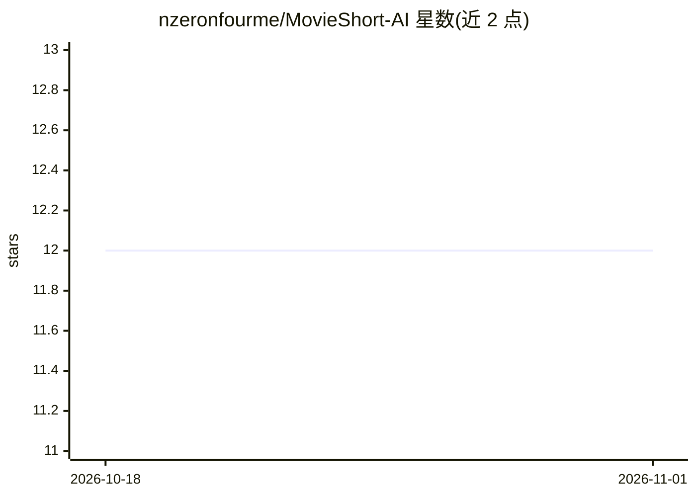

# nzeronfourme/MovieShort-AI

⭐ 12 · Python · MIT · 推送 2026-09-13 · [GitHub](https://github.com/nzeronfourme/MovieShort-AI) · 个人维护 · 中文 README

**自动将整片电影剪成 YouTube Shorts 竖屏短视频的桌面工具**

面向短视频创作者的自动化剪辑工具：PySceneDetect 检测场景边界，faster-whisper 做全片词级转录，LLM（Yandex AI Studio DeepSeek V4 / Gemini / OpenRouter / OpenCode Zen）按 1-10 分评分并给出片段名称与时间戳，OpenCV 人脸/HOG 检测做人物居中的 9:16 竖屏裁剪，FFmpeg 输出 1080×1920 带字幕与模糊背景的成品。提供无 LLM 的随机模式与手动时间码模式。Windows 下通过 setup.bat/run.bat 脚本安装运行，依赖 Python 3.9+ 与 FFmpeg，NVIDIA GPU 为可选加速。界面为英俄双语，通过浏览器 localhost:7860 访问。

## 筛选速览

| 维度 | 判定 | 备注 |
|---|---|---|
| AI 角色 | `ai-native` | 本体是模型或模型工具 |
| 许可风险 | `permissive` | MIT |
| 部署形态 | `None` |  |
| 模型依赖 | locked-api |  |
| 硬件要求 | — | 无带数字的原话,不猜 |
| 安装摩擦 | `medium` | 含编译或系统依赖之一 |
| 成熟度 | — | 结构信号不足 |

## 能力要点

- 场景检测→转录→LLM 评分→竖屏裁剪→字幕的全自动流水线
- 多 LLM 提供商支持（Yandex AI Studio DeepSeek V4 / Gemini / OpenRouter / OpenCode Zen）
- 人脸+HOG 人物跟踪的 9:16 智能居中裁剪
- 词级时间戳字幕、静音块过滤与片段多样性分配

## 适用场景

- 把整部电影自动剪成可发布的竖屏 Shorts 片段
- 批量处理多部电影并挑选评分最高的片段
- 不需要 API key 时用随机场景模式快速出片

## 场景标签

`图像视频处理` · 领域:感知与多模态

## 证据(README 行号)

> L20: - Scene detection → transcription → LLM scoring → vertical crop → subtitles
> L27: - **AI-powered clip selection** — LLM (DeepSeek / Gemini) scores each scene (1-10) with names, uses knowledge about
> L30: - **Word-level subtitles** — faster-whisper transcription with word-level timestamps, customizable font/size/color/

## 星数曲线

2026-10-18 12 → 2026-11-01 12（+0）

---
*卡片 v1 · prompt 1.4 · 生成 2026-11-01 · 置信度 high · 依据 README sha `49b8aef72a4b` · [字段定义](../../DATASET.md)*
