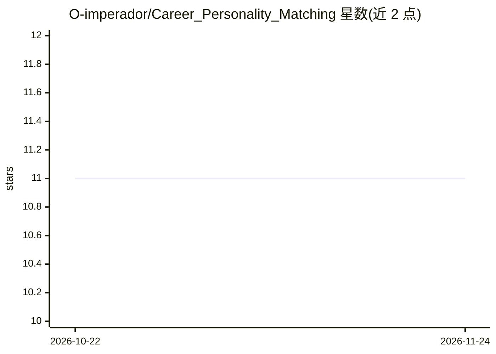

# O-imperador/Career_Personality_Matching

⭐ 11 · Jupyter Notebook · MIT · 推送 2025-12-23 · [GitHub](https://github.com/O-imperador/Career_Personality_Matching) · 个人维护

**基于个性与能力倾向分数推荐职业的练习项目**

一个小型练习项目：目标是基于 OCEAN 个性特质与能力倾向分数推荐职业。作者探索数据集后发现多数职业仅有一条样本，无法训练有意义的 ML 模型，因此改为相似度推荐方案——把每个职业表示为多维特质空间中的点，计算个体到各职业的欧氏距离，取最近的 N 个职业作为推荐；另提供 n_neighbors=1 的 KNN 分类器作为可选方案，与距离法功能等价。README 未给出安装、运行方式或代码使用说明。

## 筛选速览

| 维度 | 判定 | 备注 |
|---|---|---|
| AI 角色 | `ai-native` | 本体是模型或模型工具 |
| 许可风险 | `permissive` | MIT |
| 部署形态 | `None` |  |
| 模型依赖 | — | README 未给出锁定关系 |
| 硬件要求 | — | 无带数字的原话,不猜 |
| 安装摩擦 | `low` | 无编译、无系统依赖或容器化 |
| 成熟度 | — | 结构信号不足 |

## 能力要点

- 将职业表示为多维特质空间中的点，按欧氏距离取最近 N 个作为推荐
- KNN 分类器（n_neighbors=1）可选方案，与距离法功能等价
- 使用 OCEAN 个性特质与能力倾向分数数据

## 适用场景

- 根据个人性格与能力倾向分数获得职业推荐
- 学习相似度推荐系统的入门实现思路

## 场景标签

`推荐系统` · 领域:学习与行业

## 证据(README 行号)

> L4: The goal of this project was to create a **machine learning solution** to recommend the best career based on an indi
> L10: Instead of ML, we use a **similarity-based recommendation system**:

## 星数曲线

2026-10-22 11 → 2026-11-24 11（+0）

---
*卡片 v1 · prompt 1.4 · 生成 2026-11-19 · 置信度 mid · 依据 README sha `a61371d9e926` · [字段定义](../../DATASET.md)*
