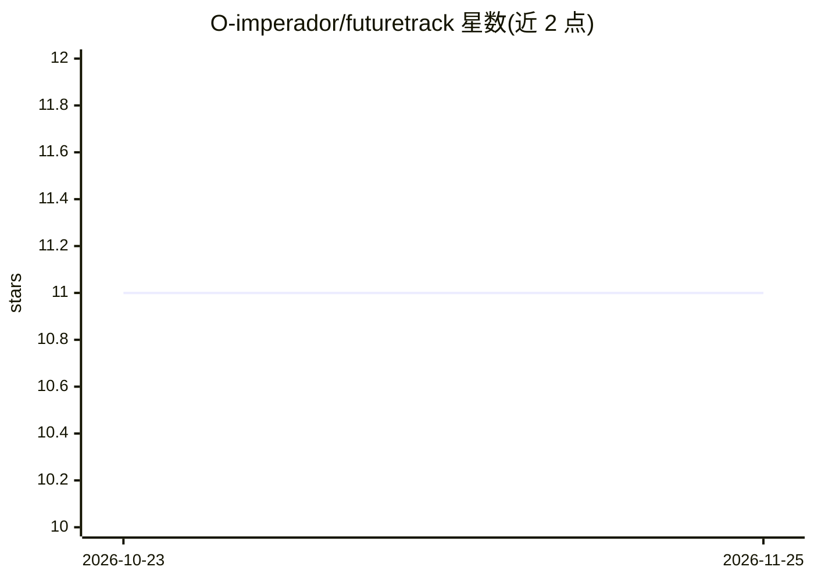

# O-imperador/futuretrack

⭐ 11 · TypeScript · 推送 2025-12-22 · [GitHub](https://github.com/O-imperador/futuretrack) · 个人维护

**面向求职者的 AI 职业指导 Web 应用**

一个自称 AI 驱动的职业指导 Web 应用，由三部分组成：Express 后端、React+Vite 前端和 Flask API，数据存储使用 MySQL。README 未说明具体 AI 功能内容，仅描述了运行所需组件：需通过 XAMPP 启动 MySQL 并导入提供的 SQL 文件，同时运行后端、前端与 Flask API 三个服务。仓库主题标签含 machine-learning，提示其 AI 部分基于机器学习实现，但具体模型与功能细节在 README 中未展开。

## 筛选速览

| 维度 | 判定 | 备注 |
|---|---|---|
| AI 角色 | `ai-native` | 本体是模型或模型工具 |
| 许可风险 | `none` | — |
| 部署形态 | `None` |  |
| 模型依赖 | — | README 未给出锁定关系 |
| 硬件要求 | — | 无带数字的原话,不猜 |
| 安装摩擦 | `low` | 无编译、无系统依赖或容器化 |
| 成熟度 | — | 结构信号不足 |

## 能力要点

- 前后端分离架构：Express 后端 + React+Vite 前端 + Flask API
- 使用 MySQL 数据库，附带可导入的 SQL 文件
- 主题标签含 machine-learning，提示含机器学习功能

## 适用场景

- 获取 AI 生成的职业路径指导
- 作为全栈 + ML 项目参考搭建类似应用

## 场景标签

`AI 助手` · 领域:对话与助手

## 证据(README 行号)

> L2: An Ai powered career guidance web application.
> L4: u also have to run the express backend, react+vite frontend and the flask api.

## 星数曲线

2026-10-23 11 → 2026-11-25 11（+0）

---
*卡片 v1 · prompt 1.4 · 生成 2026-11-19 · 置信度 low · 依据 README sha `7b81f2720d58` · [字段定义](../../DATASET.md)*
