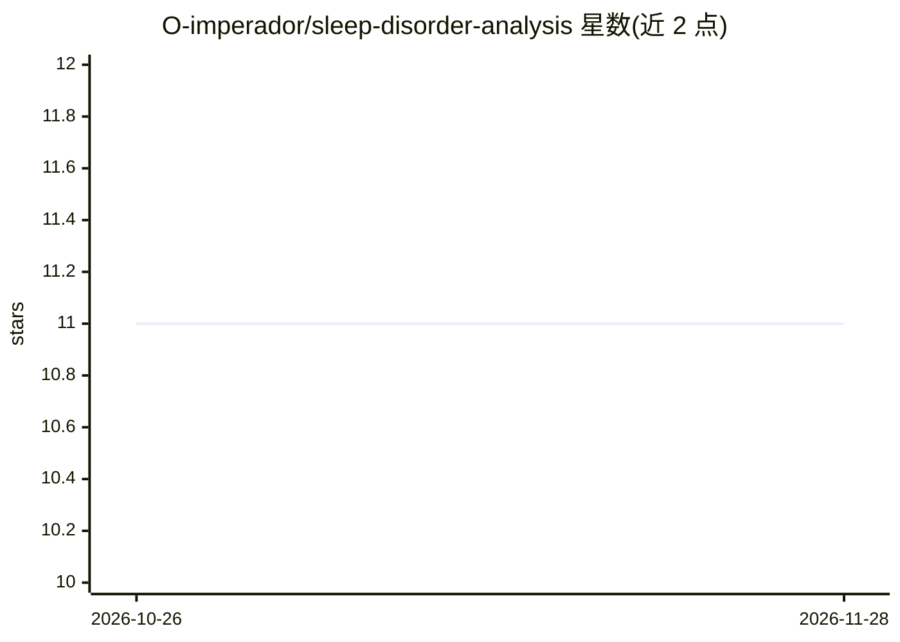

# O-imperador/sleep-disorder-analysis

⭐ 11 · Jupyter Notebook · 推送 2025-12-10 · [GitHub](https://github.com/O-imperador/sleep-disorder-analysis) · 个人维护

**数据科学学习者：清洗、探索并预测睡眠障碍的完整项目**

基于 Kaggle 睡眠健康与生活方式数据集（374 条、14 特征）的端到端数据科学项目：涵盖数据清洗（血压拆分、标签补全、列名标准化）、探索性可视化（压力/BMI/活动量与睡眠的关系、相关性矩阵）、特征工程，并训练 Random Forest 分类器预测三类睡眠状态，测试集准确率 96%。使用 Python/Pandas/Seaborn/Scikit-learn，通过 Jupyter Notebook 运行。

## 筛选速览

| 维度 | 判定 | 备注 |
|---|---|---|
| AI 角色 | `ai-native` | 本体是模型或模型工具 |
| 许可风险 | `none` | — |
| 部署形态 | `library` | 以包/库形式分发 |
| 模型依赖 | — | README 未给出锁定关系 |
| 硬件要求 | — | 无带数字的原话,不猜 |
| 安装摩擦 | `low` | 无编译、无系统依赖或容器化 |
| 成熟度 | — | 结构信号不足 |

## 能力要点

- Random Forest 分类器预测 NoDisorder/Insomnia/Sleep Apnea 三类
- 含数据清洗、特征工程、70/15/15 划分与混淆矩阵评估
- 多个探索性可视化研究压力、BMI、活动量与睡眠的关系

## 适用场景

- 学习端到端机器学习项目的完整流程
- 参考睡眠与生活方式数据的分析思路
- 作为随机森林分类任务的基线示例

## 场景标签

`数据分析` · 领域:效率与自动化

## 证据(README 行号)

> L2: A small data-science project exploring sleep patterns and building a model to predict whether a person may have a sl
> L12: 2. **Build a machine learning model** that predicts whether a person has:
> L48: The predictive model used is a **Random Forest Classifier**.

## 星数曲线

2026-10-26 11 → 2026-11-28 11（+0）

---
*卡片 v1 · prompt 1.4 · 生成 2026-11-19 · 置信度 high · 依据 README sha `ff32766430c4` · [字段定义](../../DATASET.md)*
