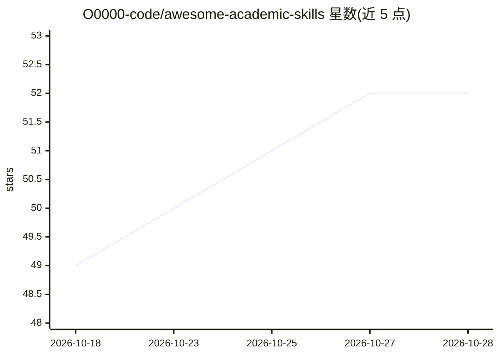

# O0000-code/awesome-academic-skills

⭐ 52 · Python · CC0-1.0 · 推送 2026-10-27 · [GitHub](https://github.com/O0000-code/awesome-academic-skills) · 个人维护 · 中文 README

**学术研究全流程的 Claude/agent 技能双语索引清单**

面向学术工作的 agent 技能策展清单（awesome list），按研�生命周期组织条目：发现与收集（文献检索、系统性综述、全文获取）、阅读与理解（精读摘要、有据问答、翻译、学习衍生品）等阶段，每个条目标注作者、许可证与运行方式（网络/hooks）。技能覆盖 CNKI、Google Scholar、OpenAlex、arXiv 等来源，兼容 Claude Code 等 agent 框架。清单本身以 CC0 发布，不提供安装命令。

## 筛选速览

| 维度 | 判定 | 备注 |
|---|---|---|
| AI 角色 | `ai-knowledge` | 知识聚合/清单类 |
| 许可风险 | `viral` | CC0-1.0 |
| 部署形态 | `library` | 以包/库形式分发 |
| 模型依赖 | — | README 未给出锁定关系 |
| 硬件要求 | — | 无带数字的原话,不猜 |
| 安装摩擦 | `medium` | 含编译或系统依赖之一 |
| 成熟度 | — | 结构信号不足 |

## 能力要点

- 按研究生命周期阶段组织技能条目
- 每条目标注许可证与运行方式（net/hooks）
- 覆盖中英文献场景：CNKI、GB/T 7714、arXiv 中译
- 条目包含检索、综述、精读、引用管理、论文转代码等类别

## 适用场景

- 为文献综述或论文精读挑选合适的 agent 技能
- 查找中文文献场景（CNKI/国标格式）相关技能
- 了解学术 agent 技能生态与各条目许可证情况

## 场景标签

`精选清单` `科研工具` · 领域:学习与行业

## 证据(README 行号)

> L5: **The research lifecycle, as agent skills.**
> L7: A bilingual index of Claude and agent skills for academic work, from literature search to peer review.
> L8: Organized by where skills fit in the research lifecycle; each entry notes its license and what it runs (network, hoo

## 星数曲线

2026-10-18 49 → 2026-10-28 52（+3）

---
*卡片 v1 · prompt 1.4 · 生成 2026-10-24 · 置信度 mid · 依据 README sha `a18d2c1f86d5` · [字段定义](../../DATASET.md)*
