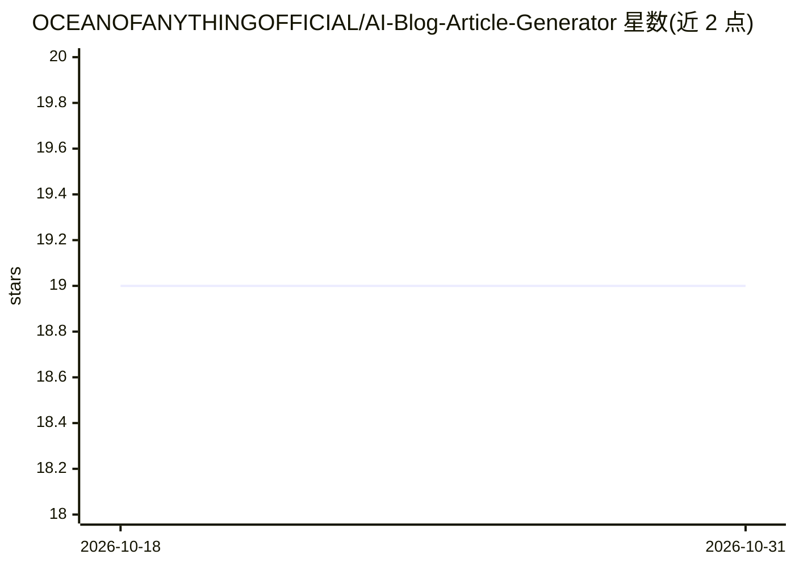

# OCEANOFANYTHINGOFFICIAL/AI-Blog-Article-Generator

⭐ 19 · Python · NOASSERTION · 推送 2026-10-29 · [GitHub](https://github.com/OCEANOFANYTHINGOFFICIAL/AI-Blog-Article-Generator) · [官网](https://ocean-of-anything.gitbook.io/ai-blog-article-generator) · 个人维护

**用 Cohere API 生成 SEO 博客文章的 Python 命令行工具**

Python 命令行工具，调用 Cohere API 按指定主题生成文章，输出 HTML、Markdown 或 GitHub README 三种格式；支持设置字数上下限、语言与输出文件名，基于内置提示词控制 SEO 优化与写作风格，并按主题从图片 API 抓取配图插入内容。使用前需自备 Cohere API key 并写入 config.py，依赖 cohere、colorama、retrying 等库，从源码运行，无打包安装途径。面向博主、内容创作者与开发者。

## 筛选速览

| 维度 | 判定 | 备注 |
|---|---|---|
| AI 角色 | `ai-native` | 本体是模型或模型工具 |
| 许可风险 | `none` | NOASSERTION |
| 部署形态 | `library` | 以包/库形式分发 |
| 模型依赖 | locked-api |  |
| 硬件要求 | — | 无带数字的原话,不猜 |
| 安装摩擦 | `low` | 无编译、无系统依赖或容器化 |
| 成熟度 | — | 结构信号不足 |

## 能力要点

- 按主题生成文章，输出 HTML/Markdown/GitHub README 三种格式
- 可设置最大/最小字数、语言与输出文件名
- 超时与重试的错误处理机制
- 按主题从图片 API 动态抓取配图插入文章

## 适用场景

- 快速生成指定主题的博客初稿
- 生成多语言内容
- 将生成内容直接转为 GitHub README 文档

## 场景标签

`AI 写作` · 领域:内容生成

## 证据(README 行号)

> L16: The **AI Blog Article Generator** is a Python-based tool that utilizes the Cohere API to generate high-quality, SEO
> L81: python aibag.py [topic] [OPTIONS]

## 星数曲线

2026-10-18 19 → 2026-10-31 19（+0）

---
*卡片 v1 · prompt 1.4 · 生成 2026-10-28 · 置信度 mid · 依据 README sha `08402be25c7a` · [字段定义](../../DATASET.md)*
