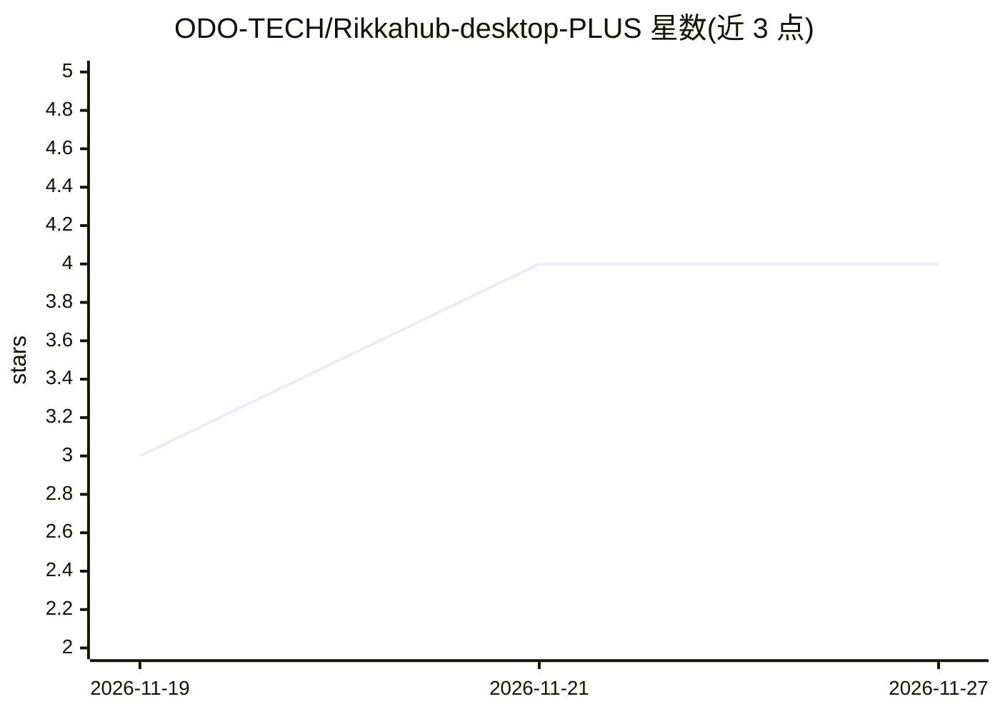

# ODO-TECH/Rikkahub-desktop-PLUS

⭐ 4 · TypeScript · NOASSERTION · 推送 2026-11-24 · [GitHub](https://github.com/ODO-TECH/Rikkahub-desktop-PLUS) · 组织维护 · 中文 README

**Windows/Linux/NAS 自托管的 LLM 桌面客户端，本地数据优先**

RikkaHub Desktop 的社区增强分支：在多供应商接入、助手/提示词、MCP 基础上新增 WinForms+WebView2 原生 Windows 壳、SQLite（FTS5）本地存储与 12 项细粒度备份、绑定本地/SSH 目录的智能体工作区（读写文件、shell、stdio MCP、并行子智能体）、记忆混合召回与非破坏式上下文压缩，并提供面向 Linux NAS 的 Docker 编排。通过审批档位、路径边界与沙盒/挂载表构成三层写入控制。macOS 不发布。

## 筛选速览

| 维度 | 判定 | 备注 |
|---|---|---|
| AI 角色 | `ai-native` | 本体是模型或模型工具 |
| 许可风险 | `none` | NOASSERTION |
| 部署形态 | `desktop` | 安装包/桌面程序 |
| 模型依赖 | locked-api |  |
| 硬件要求 | — | 无带数字的原话,不猜 |
| 安装摩擦 | `low` | 无编译、无系统依赖或容器化 |
| 成熟度 | — | 结构信号不足 |

## 能力要点

- 内置 21 个供应商预设，支持 OpenAI/Anthropic/Google 兼容端点
- 工作区绑定本地或 SSH 目录，模型获得 read/write/bash/grep 等工具
- stdio MCP 与 Streamable HTTP 双传输，支持 OAuth 2.1 与 mcpServers JSON 导入
- 三层写入边界：审批档位、路径前缀校验、Windows 低完整性令牌或容器挂载表

## 适用场景

- 在 Windows 桌面上本地管理多供应商 LLM 会话与数据
- 让 agent 在指定文件夹或 SSH 远程目录内读写代码并执行 shell
- 部署到飞牛 OS 等 Linux NAS，通过浏览器访问自托管助手
- 通过 QQ/微信配对在手机上调用桌面端助手

## 场景标签

`AI 助手` `编码 Agent` · 领域:编码与开发

## 证据(README 行号)

> L5:  Windows、Linux 与 Docker 自托管的 LLM 桌面客户端 · 多供应商 · 本地数据优先
> L81: 内置 21 个供应商预设（OpenAI、ChatGPT、Anthropic、Claude、Gemini、xAI、Grok、DeepSeek、智谱、月之暗面、Kimi Code、阿里云百炼、火山引擎、腾讯混元、MiniMax、MIM
> L43: 模型拿到的工作区工具是 `read`、`read_files`、`write`、`edit`、`bash`，无 bash 的机器上另有 `grep`、`find`、`ls`，与安卓端的能力面一致。除此之外还有网页搜索与抓取、剪贴板

## 星数曲线

2026-11-19 3 → 2026-11-27 4（+1）

---
*卡片 v1 · prompt 1.4 · 生成 2026-11-21 · 置信度 high · 依据 README sha `e2296ef34e84` · [字段定义](../../DATASET.md)*
