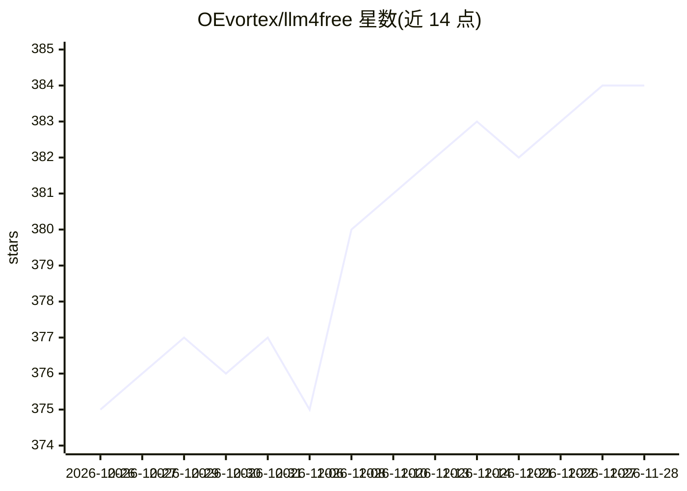

# OEvortex/llm4free

⭐ 384 · Python · Apache-2.0 · 推送 2026-11-03 · [GitHub](https://github.com/OEvortex/llm4free) · [官网](https://pypi.org/project/llm4free/) · 个人维护

**Python 库：将 40+ 免费第三方 AI 网站后端统一为 OpenAI 兼容接口**

LLM4Free 收集经逆向工程得到的第三方 AI 网站后端，统一适配为 OpenAI SDK 形式的接口，覆盖 31 个聊天、13 个文生图、14 个 TTS、2 个 STT 提供商，以及 8 个搜索引擎。统一 Client 提供自动提供商选择、模型解析、实例缓存与故障转移，并内置 FastAPI 服务器暴露 OpenAI/Anthropic 兼容端点，附 CLI 工具。多数免费提供商无需 API key；README 声明第三方端点可能随时变化、限流或封禁，可用性为尽力而为，用户需自行遵守各提供商服务条款。

## 筛选速览

| 维度 | 判定 | 备注 |
|---|---|---|
| AI 角色 | `ai-ecosystem` | LLM/agent 周边工具 |
| 许可风险 | `permissive` | Apache-2.0 |
| 部署形态 | `self-host` | docker 或自建部署 |
| 模型依赖 | local-ok | 支持本地模型 |
| 硬件要求 | — | 无带数字的原话,不猜 |
| 安装摩擦 | `low` | 无编译、无系统依赖或容器化 |
| 成熟度 | — | 结构信号不足 |

## 能力要点

- 40+ 免费后端统一为 chat.completions/images.generate/audio 接口
- 自动提供商选择、模型解析、缓存与 failover
- FastAPI 服务器暴露 OpenAI /v1 与 Anthropic /v1/messages 端点
- CLI 提供搜索、天气、翻译、地图等命令

## 适用场景

- 无需 API key 直接调用多家免费 LLM 聊天后端
- 将逆向后端作为本地 OpenAI 兼容 API 服务给现有客户端使用
- 统一入口做多提供商文本生成、生图与语音合成
- 用 CLI 快速做网页搜索与查询工具

## 场景标签

`模型网关` · 领域:Agent 开发

## 证据(README 行号)

> L28: LLM4Free is a Python package that collects **reverse-engineered backends for third-party AI websites** and exposes 
> L36: - **Serving:** a FastAPI server exposing OpenAI- and Anthropic-compatible endpoints
> L63: |API server|OpenAI `/v1` routes plus Anthropic `/v1/messages` compatibility|

## 星数曲线

2026-10-26 375 → 2026-11-28 384（+9）

---
*卡片 v1 · prompt 1.4 · 生成 2026-11-25 · 置信度 high · 依据 README sha `5bea7e4febe0` · [字段定义](../../DATASET.md)*
