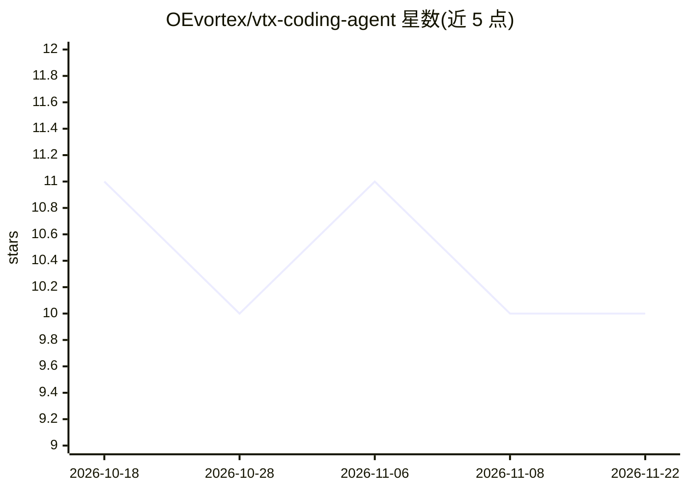

# OEvortex/vtx-coding-agent

⭐ 10 · Python · Apache-2.0 · 推送 2026-11-12 · [GitHub](https://github.com/OEvortex/vtx-coding-agent) · 组织维护

**终端里的极简 coding agent harness，TUI 与无头 CLI 双形态**

Vtx 是一个 coding agent harness：给定目标和工作目录后，它读取文件、运行命令、编辑代码，自动完成多步任务。同一核心提供三种运行方式——键盘驱动的 Textual TUI、面向脚本和 CI 的无头 CLI、用于嵌入的 Python SDK。机制上采用插件行组合架构（工具注册表、provider 接缝、会话日志、权限门、agent 循环均为可替换的行），自带 62 个 provider、16 个 API 家族、14 个工具、AGENTS.md 与 skills 上下文、可分支的持久会话。需 Python 3.12+，Apache 2.0 许可。

## 筛选速览

| 维度 | 判定 | 备注 |
|---|---|---|
| AI 角色 | `ai-ecosystem` | LLM/agent 周边工具 |
| 许可风险 | `permissive` | Apache-2.0 |
| 部署形态 | `library` | 以包/库形式分发 |
| 模型依赖 | — | README 未给出锁定关系 |
| 硬件要求 | — | 无带数字的原话,不猜 |
| 安装摩擦 | `low` | 无编译、无系统依赖或容器化 |
| 成熟度 | — | 结构信号不足 |

## 能力要点

- 插件行组合架构：所有子系统可经配置替换而无需改 harness
- 62 个 provider / 16 个 API 家族，YAML 文件可自定义 provider
- 持久可分支会话：恢复上次、中途 fork 探索、快照回滚
- codemode 脚本在独立 worker 进程运行，超时用 kill 终止

## 适用场景

- 在终端里让 agent 自动完成改代码、写测试等多步任务
- 在 CI 或脚本中以无头模式批量跑编码任务
- 通过 Python SDK 把 agent 运行时嵌入自己的应用
- 自定义 provider 与工具，组合自己的 agent 配置

## 场景标签

`编码 Agent` `Agent 框架` · 领域:Agent 开发

## 证据(README 行号)

> L12: Vtx is a coding agent harness. Give it a goal and a working folder, and it reads files,
> L17: It ships 11 packages under the single `vtx-coding-agent` distribution, with 62 providers,
> L126: |**@vtx.agent**|Product-neutral harness: loop, turn engine, sessions, tool registry, prompts, hooks, goals, SDK|

## 星数曲线

2026-10-18 11 → 2026-11-22 10（-1）

---
*卡片 v1 · prompt 1.4 · 生成 2026-11-20 · 置信度 high · 依据 README sha `41b8fd1c8ddf` · [字段定义](../../DATASET.md)*
