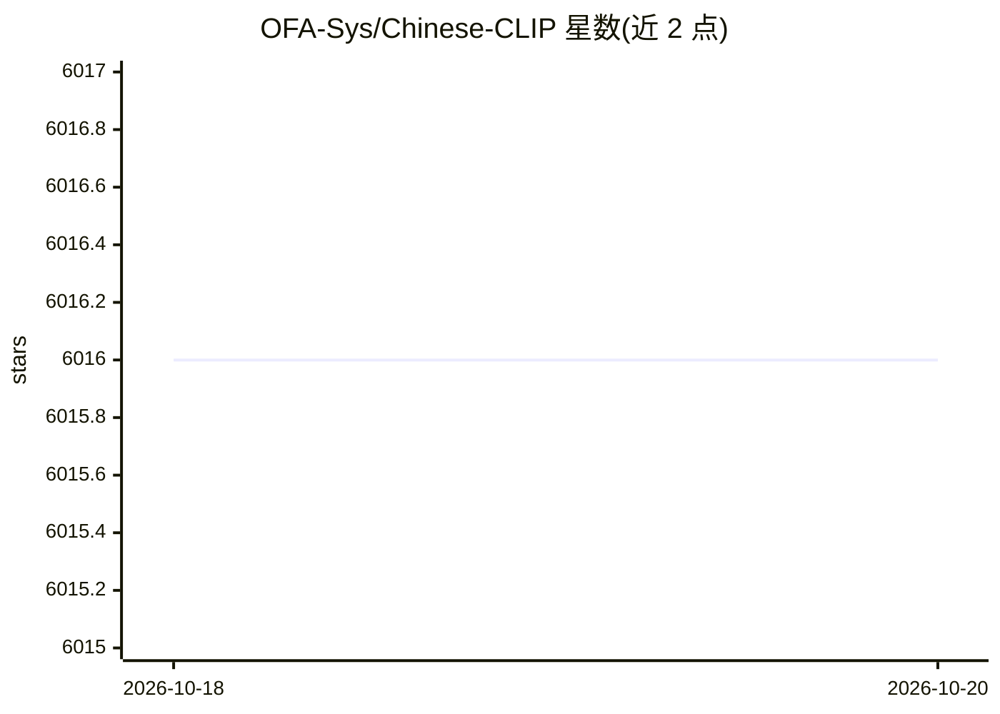

# OFA-Sys/Chinese-CLIP

⭐ 6,016 · Jupyter Notebook · MIT · 推送 2026-03-31 · [GitHub](https://github.com/OFA-Sys/Chinese-CLIP) · 组织维护 · 中文 README

**CLIP 模型的中文版本，用于中文图文检索与特征计算**

基于 open_clip 项目建设的中文 CLIP 实现，使用约 2 亿中文图文对训练，开源 5 个规模（RN50 至 ViT-H/14，77M-958M 参数）的预训练模型，托管于 Hugging Face 与魔搭社区。提供特征提取与相似度计算 API、跨模态检索 finetune/推理/KNN/评测代码、ELEVATER 零样本图像分类流程，支持 ONNX/TensorRT/CoreML 部署转换。训练环境要求 Python>=3.6.4、PyTorch>=1.8.0、CUDA>=10.2，支持 FlashAttention、梯度累积等训练配置。

## 筛选速览

| 维度 | 判定 | 备注 |
|---|---|---|
| AI 角色 | `ai-native` | 本体是模型或模型工具 |
| 许可风险 | `permissive` | MIT |
| 部署形态 | `library` | 以包/库形式分发 |
| 模型依赖 | — | README 未给出锁定关系 |
| 硬件要求 | — | 无带数字的原话,不猜 |
| 安装摩擦 | `medium` | 含编译或系统依赖之一 |
| 成熟度 | — | 结构信号不足 |

## 能力要点

- 5 个规模预训练模型（RN50/ViT-B-16/ViT-L-14/ViT-L-14-336/ViT-H-14）
- 图文特征提取与相似度计算 API，几行代码调用
- 跨模态检索 finetune、特征提取、KNN 检索与 Recall 评测全流程代码
- ONNX/TensorRT/CoreML 部署转换支持，代码合入 Huggingface transformers

## 适用场景

- 对中文图文数据做跨模态检索与相似度计算
- 在 MUGE/Flickr30K-CN 等数据集上 finetune 中文 CLIP 模型
- 中文零样本图像分类评测
- 将模型转换为 ONNX/TensorRT 后部署特征推理服务

## 场景标签

`多模态` `语义搜索` `微调` · 领域:知识与检索

## 证据(README 行号)

> L5: 本项目为CLIP模型的**中文**版本，使用大规模中文数据进行训练（~2亿图文对），旨在帮助用户快速实现中文领域的图文特征&相似度计算、跨模态检索、零样本图片分类等任务。本项目代码基于 open_clip project 建设，并针
> L20: * 2022.7.13 新增图文特征提取快速API，几行代码快速调用中文CLIP模型，计算图文特征&相似度

## 星数曲线

2026-10-18 6,016 → 2026-10-20 6,016（+0）

---
*卡片 v1 · prompt 1.4 · 生成 2026-10-20 · 置信度 high · 依据 README sha `5e9b72b0e2ef` · [字段定义](../../DATASET.md)*
