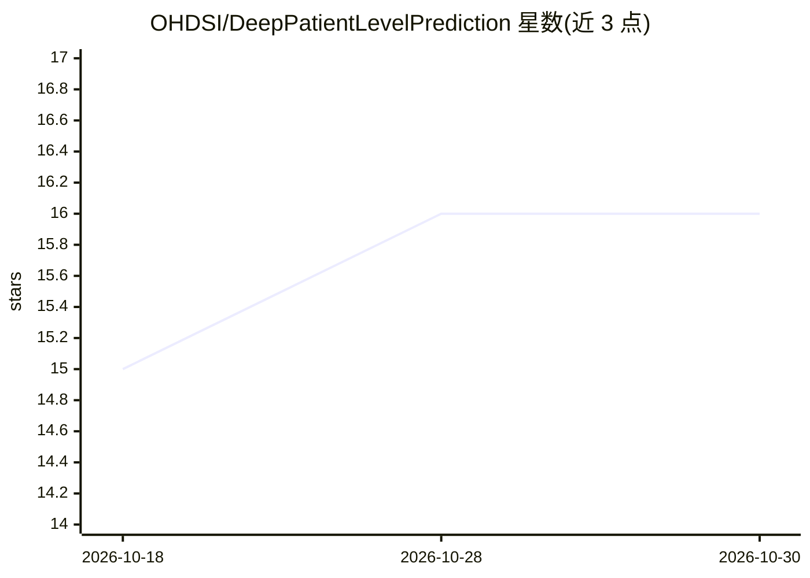

# OHDSI/DeepPatientLevelPrediction

⭐ 16 · R · 推送 2026-10-09 · [GitHub](https://github.com/OHDSI/DeepPatientLevelPrediction) · [官网](https://ohdsi.github.io/DeepPatientLevelPrediction) · 组织维护

**医疗观察数据上构建深度学习患者级预测模型的 R 包**

OHDSI 生态的 R 包，在 OMOP Common Data Model 格式的观察性医疗数据上构建并验证深度学习患者级预测模型，扩展 PatientLevelPrediction 框架；内置 MLP、ResNet、Transformer、RealMLP 模型，也支持用户添加自定义深度学习模型，并可复用框架的验证与性能探索功能。深度学习部分通过 reticulate 调用 Python PyTorch 完成训练与推理。要求 R 4.1.0+ 与 Python 3.10+，大模型开发建议使用 NVIDIA GPU。面向医疗数据科研与开发人员。

## 筛选速览

| 维度 | 判定 | 备注 |
|---|---|---|
| AI 角色 | `ai-native` | 本体是模型或模型工具 |
| 许可风险 | `none` | — |
| 部署形态 | `None` |  |
| 模型依赖 | — | README 未给出锁定关系 |
| 硬件要求 | — | 无带数字的原话,不猜 |
| 安装摩擦 | `low` | 无编译、无系统依赖或容器化 |
| 成熟度 | — | 结构信号不足 |

## 能力要点

- 在 OMOP CDM 数据上构建患者级深度学习预测模型
- 内置 MLP、ResNet、Transformer、RealMLP 模型，支持自定义模型
- 通过 reticulate 调用 Python PyTorch 进行训练与推理
- 复用 PatientLevelPrediction 框架的验证与性能探索功能

## 适用场景

- 利用电子病历观察数据训练患者级风险预测模型
- 在 OHDSI PatientLevelPrediction 流程中接入深度学习模型
- 对已有队列数据验证和比较多种深度学习架构的预测性能

## 场景标签

 · 领域:医疗健康/流行病学预测建模

## 证据(README 行号)

> L8: DeepPatientLevelPrediction is an R package for building and validating deep learning patient-level predictive models
> L15: - Includes MLP, ResNet, Transformer, and RealMLP models.

## 星数曲线

2026-10-18 15 → 2026-10-30 16（+1）

---
*卡片 v1 · prompt 1.4 · 生成 2026-10-30 · 置信度 high · 依据 README sha `0037883d8dba` · [字段定义](../../DATASET.md)*
