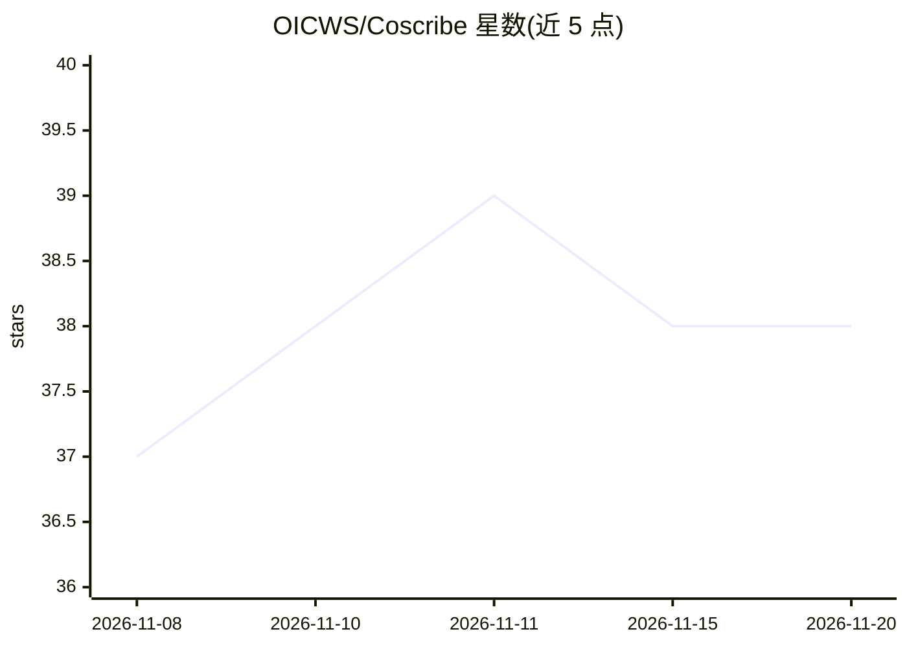

# OICWS/Coscribe

⭐ 38 · Python · MIT · 推送 2026-11-19 · [GitHub](https://github.com/OICWS/Coscribe) · [官网](https://oicws.github.io/Coscribe/) · 组织维护

**本地办公助手：读写文件并生成 Office/PDF 文档的 agent**

面向办公场景的本地 agent 助手：读取和写入本地文件，生成 Word、Excel、PowerPoint 与 PDF 文档，可通过渲染页面检查输出质量，制作幻灯片、设计与仪表盘供用户在对话旁编辑；支持连接网页与外部工具，并可按计划重复执行任务。模型侧支持 Anthropic、OpenAI、Gemini 直连及任意 OpenAI 兼容 API（DeepSeek、Kimi、GLM、本地运行器）。提供权限模式与风险工具审批机制，仅需模型 API key 即可运行；以 Python 后端 + React 前端 + Electron 桌面壳的仓库形式分发，需自行构建。

## 筛选速览

| 维度 | 判定 | 备注 |
|---|---|---|
| AI 角色 | `ai-native` | 本体是模型或模型工具 |
| 许可风险 | `permissive` | MIT |
| 部署形态 | `library` | 以包/库形式分发 |
| 模型依赖 | — | README 未给出锁定关系 |
| 硬件要求 | — | 无带数字的原话,不猜 |
| 安装摩擦 | `low` | 无编译、无系统依赖或容器化 |
| 成熟度 | — | 结构信号不足 |

## 能力要点

- 生成 .pptx/.docx/.xlsx 文档并通过渲染页面检查
- 支持 Anthropic/OpenAI/Gemini 直连及任意 OpenAI 兼容 API
- 连接器一次登录与可预读的技能（指令与文件目录）
- 权限模式、风险工具审批与按计划重复执行

## 适用场景

- 通过对话生成并编辑办公文档、幻灯片与仪表盘
- 让 agent 定时重复执行办公流程
- 接入自己的模型 API 完成本地办公自动化

## 场景标签

`AI 助手` `工作流自动化` `AI 写作` · 领域:效率与自动化

## 证据(README 行号)

> L5: A local, user-friendly assistant for office work. It reads and writes your
> L15: - **Your models.** Anthropic, OpenAI and Gemini directly, and any

## 星数曲线

2026-11-08 37 → 2026-11-20 38（+1）

---
*卡片 v1 · prompt 1.4 · 生成 2026-11-18 · 置信度 mid · 依据 README sha `0be2ef12e565` · [字段定义](../../DATASET.md)*
