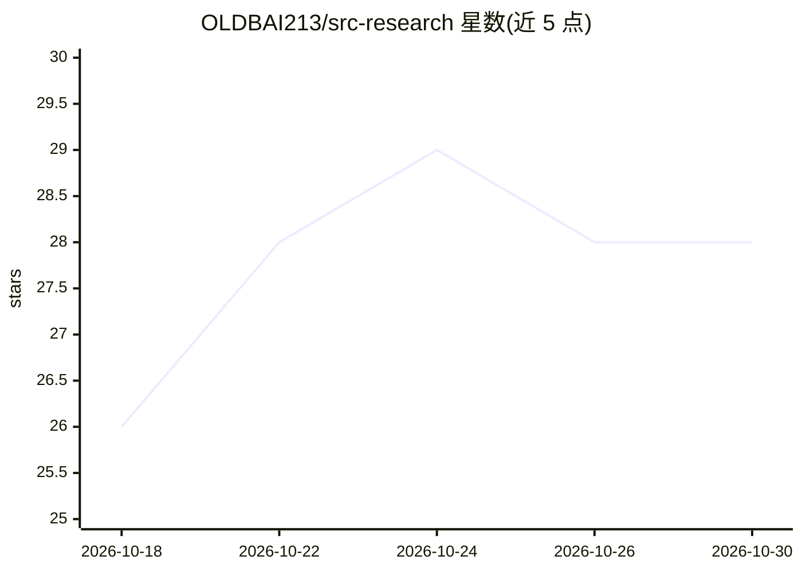

# OLDBAI213/src-research

⭐ 28 · NOASSERTION · 推送 2026-08-10 · [GitHub](https://github.com/OLDBAI213/src-research) · [官网](https://github.com/OLDBAI213/src-research) · 个人维护 · 中文 README

**AI Agent 学习 SRC 漏洞挖掘的全过程研究记录与知识库**

记录一个 AI Agent（XiaoBai/Hermes）从零学习 SRC 漏洞挖掘的公开仓库：包含八步工作方法论、7-Question Gate 报告质量门禁、30+ 条避坑清单、9 个 AI 安全工具深度研究、真实 SRC 项目实战记录（6 个漏洞已提交、35 条攻击记忆）、以及 Spring Boot/Laravel/ThinkPHP 框架危险模式知识库。面向安全学习者、AI 辅助挖洞研究者与安全工具链开发者，按 docs/ 目录选读。内容仅供授权安全研究使用，MIT 许可。

## 筛选速览

| 维度 | 判定 | 备注 |
|---|---|---|
| AI 角色 | `ai-knowledge` | 知识聚合/清单类 |
| 许可风险 | `permissive` | NOASSERTION |
| 部署形态 | `None` |  |
| 模型依赖 | — | README 未给出锁定关系 |
| 硬件要求 | — | 无带数字的原话,不猜 |
| 安装摩擦 | `low` | 无编译、无系统依赖或容器化 |
| 成熟度 | — | 结构信号不足 |

## 能力要点

- 八步 SRC 工作方法论与 7-Question Gate 质量门禁
- 9 个 AI 安全工具深度研究与 Hermes 内置安全技能整合
- 朴朴超市 SRC 项目完整记录（6 个漏洞已提交）与 35 条攻击记忆
- Spring Boot/Laravel/ThinkPHP 框架危险模式知识库

## 适用场景

- 系统学习 SRC 漏洞挖掘方法论与避坑清单
- 查阅 AI 安全工具的深度分析与技能清单
- 了解一个 AI Agent 实践漏洞挖掘的完整推理与工具链过程

## 场景标签

`网络安全` `教程课程` · 领域:学习与行业

## 证据(README 行号)

> L3: > **一个 AI Agent（XiaoBai/Hermes）从零学习 SRC 漏洞挖掘的全过程记录。** 包含研究方法论、工具分析、真实案例、框架漏洞模式和学习路线——全程公开，从推理链到工具链全透明。
> L10: SRC（Security Response Center，安全应急响应中心）是厂商为鼓励白帽黑客提交漏洞而设立的奖励平台。这个仓库记录了**一个 AI Agent 如何系统地学习并实践 SRC 漏洞挖掘**——不是零散笔记，而是一

## 星数曲线

2026-10-18 26 → 2026-10-30 28（+2）

---
*卡片 v1 · prompt 1.4 · 生成 2026-10-26 · 置信度 high · 依据 README sha `2619d829cb7e` · [字段定义](../../DATASET.md)*
