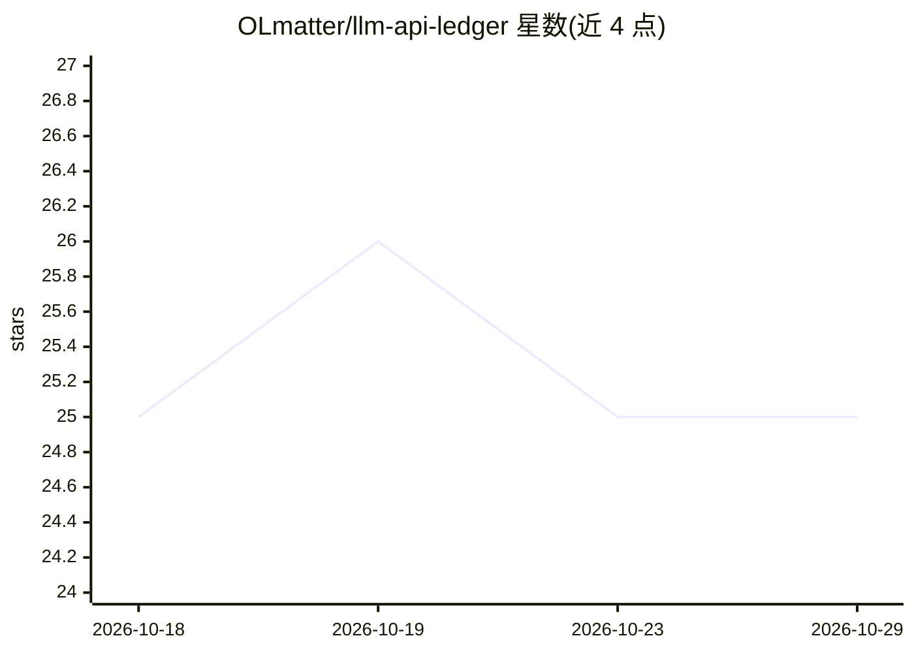

# OLmatter/llm-api-ledger

⭐ 25 · Python · GPL-3.0 · 推送 2026-09-12 · [GitHub](https://github.com/OLmatter/llm-api-ledger) · [官网](https://olmatter.github.io/llm-api-ledger/) · 个人维护 · 中文 README

**本地探针 + 众包榜单：核验国内 LLM Coding Plan 真实用量与性能**

面向国内 LLM API 套餐购买者的透明账本项目：本地部署透传代理探针（改 IDE base_url 后透明转发流量），采集 token 用量、TTFT/TPS、缓存命中率、状态码与超时等 6 类指标，与厂商 monitor API 及套餐标称三方交叉验证；用户可导出脱敏数据包提 PR，汇聚成厂商×套餐横评榜单。探针用 Python+FastAPI+SQLite 实现，PyInstaller 打包为单二进制，无 Docker 依赖。当前处阶段 0（v0.1.0-alpha），仅在维护者本人环境验证，榜单尚未上线。

## 筛选速览

| 维度 | 判定 | 备注 |
|---|---|---|
| AI 角色 | `ai-ecosystem` | LLM/agent 周边工具 |
| 许可风险 | `viral` | GPL-3.0 |
| 部署形态 | `desktop` | 安装包/桌面程序 |
| 模型依赖 | locked-api |  |
| 硬件要求 | — | 无带数字的原话,不猜 |
| 安装摩擦 | `low` | 无编译、无系统依赖或容器化 |
| 成熟度 | `idea` | |

## 能力要点

- 本地透传探针核账：标称额度 vs 实测用量 vs 官方 monitor 三方对照
- 6 类指标体系，含真伪识别（缓存命中率、模型一致性）
- Token 存系统 keychain，导出数据包脱敏且只保留 token 后 4 位
- Windows/Linux/macOS 三平台单二进制，无 Docker 依赖

## 适用场景

- 购买 Coding Plan 前查证套餐实际可用量与计费倍率
- 核对自己套餐被扣的 token 是否与厂商宣称一致
- 区分报错与超时，识别限流与超售
- 跑 7 天探针后提 PR 上报数据共建榜单

## 场景标签

`模型评测` `LLM 可观测性` · 领域:评测与运维

## 证据(README 行号)

> L35: 一个**本地探针 + 厂商套餐横评榜单**。你装探针自用核账（查自己被吞了多少 Token），脱敏数据可上传/提 PR 汇聚成套餐画像，平台按厂商×套餐交叉验证后公开榜单。
> L38: - **数据来源**：本地透传探针 + 厂商官方 monitor API（三方交叉验证）
> L101: 打开 `http://127.0.0.1:8080/__ledger__` 看：

## 星数曲线

2026-10-18 25 → 2026-10-29 25（+0）

---
*卡片 v1 · prompt 1.4 · 生成 2026-10-27 · 置信度 high · 依据 README sha `8cba79b1197a` · [字段定义](../../DATASET.md)*
