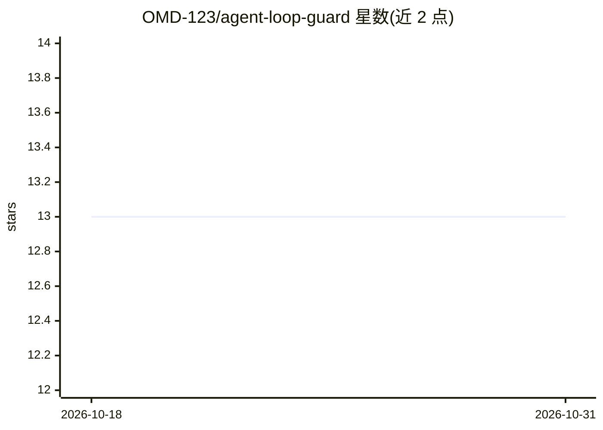

# OMD-123/agent-loop-guard

⭐ 13 · TypeScript · MIT · 推送 2026-10-10 · [GitHub](https://github.com/OMD-123/agent-loop-guard) · [官网](https://github.com/OMD-123/agent-loop-guard#readme) · 个人维护

**TypeScript AI agent 护栏库：拦截循环、注入与幻觉等失败模式**

零依赖的 TypeScript 安全层库，以插件式 Guardrail 编排器拦截 agent 生命周期中的每个 step，经模块化 checker 校验：LoopGuard 用 max-steps、时长与重复检测阻断失控循环，SecurityGuard 检测提示注入与不安全内容，HallucinationGuard 对照工具数据核验回答，LogicGuard 支持自定义校验函数。声称与 OpenAI、Anthropic、LangChain、Vercel AI SDK 及本地模型配合使用。以 npm 包提供。v2 单类 API 已弃用，迁移到 v3 编排器模式。

## 筛选速览

| 维度 | 判定 | 备注 |
|---|---|---|
| AI 角色 | `ai-ecosystem` | LLM/agent 周边工具 |
| 许可风险 | `permissive` | MIT |
| 部署形态 | `library` | 以包/库形式分发 |
| 模型依赖 | — | README 未给出锁定关系 |
| 硬件要求 | — | 无带数字的原话,不猜 |
| 安装摩擦 | `low` | 无编译、无系统依赖或容器化 |
| 成熟度 | — | 结构信号不足 |

## 能力要点

- 插件式安全管线：Loop/Security/Hallucination/Logic 四类 checker 可组合
- 零外部运行时依赖，有界历史保证 O(1) 内存
- 提供商无关，声称可配合多种 LLM SDK 与本地模型
- README 给出延迟/内存/吞吐基准数据

## 适用场景

- 防止 agent 无限工具调用导致 API 成本失控
- 拦截提示注入与不安全输出
- 校验 LLM 回答与工具结果的一致性
- 为业务规则配置自定义 step 校验

## 场景标签

`Agent 框架` · 领域:Agent 开发

## 证据(README 行号)

> L14: The framework operates as a **Deterministic Safety Proxy**. Instead of guessing, it intercepts every "step" in your
> L42: - **LoopGuard**: Stops runaway execution via max-steps, wall-clock duration, and repetition detection.

## 星数曲线

2026-10-18 13 → 2026-10-31 13（+0）

---
*卡片 v1 · prompt 1.4 · 生成 2026-10-31 · 置信度 high · 依据 README sha `c7c20aa6ea7c` · [字段定义](../../DATASET.md)*
