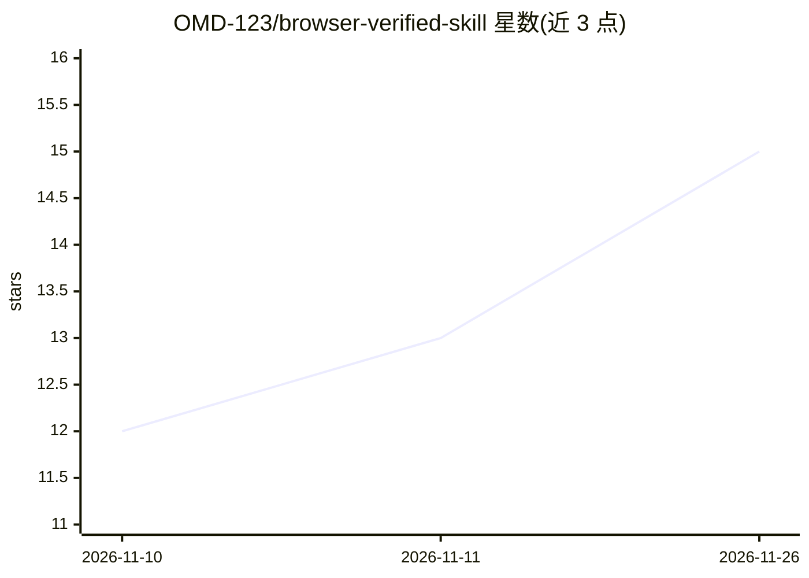

# OMD-123/browser-verified-skill

⭐ 15 · TypeScript · MIT · 推送 2026-11-14 · [GitHub](https://github.com/OMD-123/browser-verified-skill) · [官网](https://github.com/OMD-123/browser-verified-skill#readme) · 个人维护

**给 AI agent 的带审计证据的浏览器自动化技能**

以 Agent Skill（MCP server、SKILL.md 或 CLI `bv`）形式接入 Claude Code/Hermes 等 agent，使其驱动真实浏览器：每个动作经策略引擎分类与放行，run 留下可 diff 的无障碍树快照与审计日志，成功条件对照真实页面校验。内置 plan-lock、污点追踪、提示注入防护、一次性审批令牌与 AES-256-GCM 密钥库。`bv compile` 把运行编译为纯 Playwright 脚本，`bv replay` 零 LLM 成本确定性重放，`--heal` 从回退定位链修复漂移。不做隐身、不绕过 CAPTCHA 与 robots.txt。Mode A 无需 API key。

## 筛选速览

| 维度 | 判定 | 备注 |
|---|---|---|
| AI 角色 | `ai-ecosystem` | LLM/agent 周边工具 |
| 许可风险 | `permissive` | MIT |
| 部署形态 | `library` | 以包/库形式分发 |
| 模型依赖 | — | README 未给出锁定关系 |
| 硬件要求 | — | 无带数字的原话,不猜 |
| 安装摩擦 | `low` | 无编译、无系统依赖或容器化 |
| 成熟度 | — | 结构信号不足 |

## 能力要点

- 所有路径共用一个策略引擎 evaluateAction，无绕过通道
- 7 类语义化退出码契约（policy denied / needs approval / injection block 等）
- run 编译为纯 Playwright 脚本，重放零 LLM 成本
- 8 层安全模型：策略、plan-lock、审批、污点、注入防护、密钥库、dry-run、合规

## 适用场景

- 让 agent 填表/提交等浏览器操作留下可审计证据
- 把 agent 一次性探索的流程固化为可免费重放的 E2E 测试
- 控制 agent 在支付、发消息等敏感操作前需人工审批
- 无头/CI 环境中带审批流程地运行浏览器自动化

## 场景标签

`浏览器自动化` · 领域:效率与自动化

## 证据(README 行号)

> L28: `browser-verified-skill` (CLI: `bv`) is an open-source **Agent Skill** for browser
> L30: the CLI — and the agent can drive a real browser while every action passes a policy gate,
> L189: The single most important property: **there is one safety gate, and every path through

## 星数曲线

2026-11-10 12 → 2026-11-26 15（+3）

---
*卡片 v1 · prompt 1.4 · 生成 2026-11-18 · 置信度 high · 依据 README sha `f81c3f814856` · [字段定义](../../DATASET.md)*
