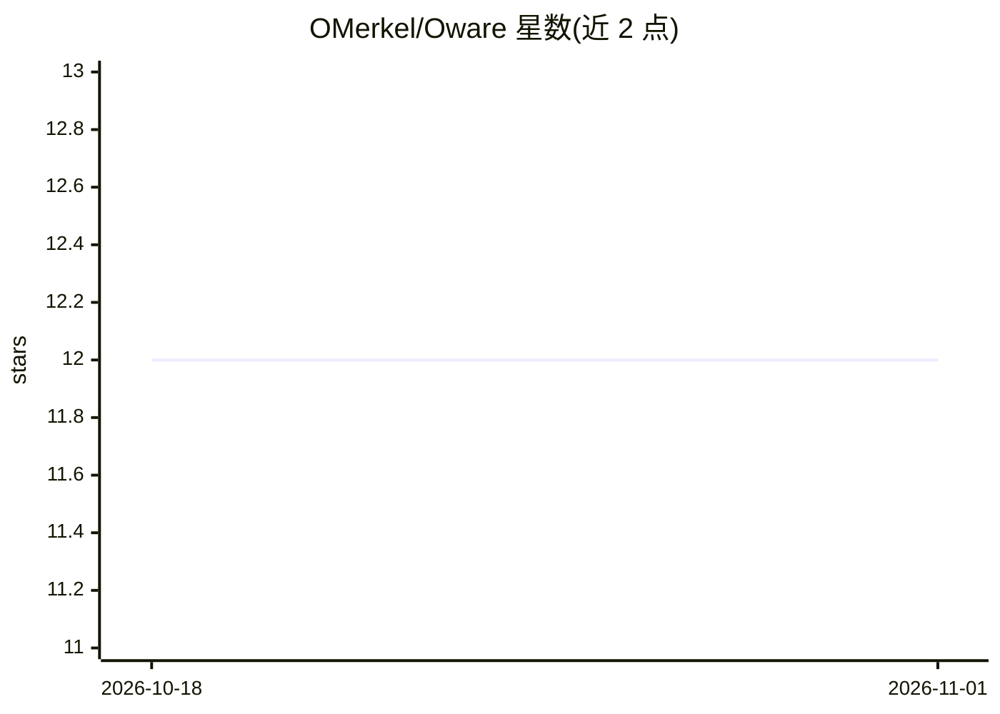

# OMerkel/Oware

⭐ 12 · JavaScript · NOASSERTION · 推送 2026-09-20 · [GitHub](https://github.com/OMerkel/Oware) · [官网](http://omerkel.github.io/Oware/html5/src) · 个人维护

**传统非洲 Mancala 棋类 Oware/Ouril 的 HTML5 网页对弈实现**

以 HTML5/Javascript/CSS 实现加纳 Oware 与佛得角 Ouril 两种传统 Mancala 棋类的双人完备信息策略棋盘游戏。默认双人本地对弈，可在选项菜单中为一方或双方启用电脑 AI 玩家，其算法为带 UCB 的蒙特卡洛树搜索（UCT）。支持在桌面与移动浏览器在线游玩，并提供 Android APK（最低 Android 4.4.2/API-19）；README 同时内嵌完整 Oware 规则说明。

## 筛选速览

| 维度 | 判定 | 备注 |
|---|---|---|
| AI 角色 | `ai-enhanced` | 去掉 AI 部分产品仍成立 |
| 许可风险 | `none` | NOASSERTION |
| 部署形态 | `None` |  |
| 模型依赖 | — | README 未给出锁定关系 |
| 硬件要求 | — | 无带数字的原话,不猜 |
| 安装摩擦 | `low` | 无编译、无系统依赖或容器化 |
| 成熟度 | — | 结构信号不足 |

## 能力要点

- 实现 Oware 与 Ouril 两套规则，可在选项菜单切换
- 电脑 AI 玩家采用 MCTS+UCT 算法，可执一方或双方
- HTML5 跨平台：桌面与移动浏览器均可运行
- 提供 Android APK（最低 Android 4.4.2）

## 适用场景

- 在浏览器或手机上玩传统非洲 Mancala 棋类
- 与 MCTS 电脑 AI 对弈或观察 AI 自对弈
- 学习 Oware/Ouril 的完整规则

## 场景标签

 · 领域:游戏/娱乐

## 证据(README 行号)

> L15: Via options menu the computer players can be activated playing one or both sides.
> L16: The computer AI player has a Monte-Carlo Tree Search (MCTS) algorithm implemented.

## 星数曲线

2026-10-18 12 → 2026-11-01 12（+0）

---
*卡片 v1 · prompt 1.4 · 生成 2026-11-01 · 置信度 high · 依据 README sha `df1d6e2166a2` · [字段定义](../../DATASET.md)*
