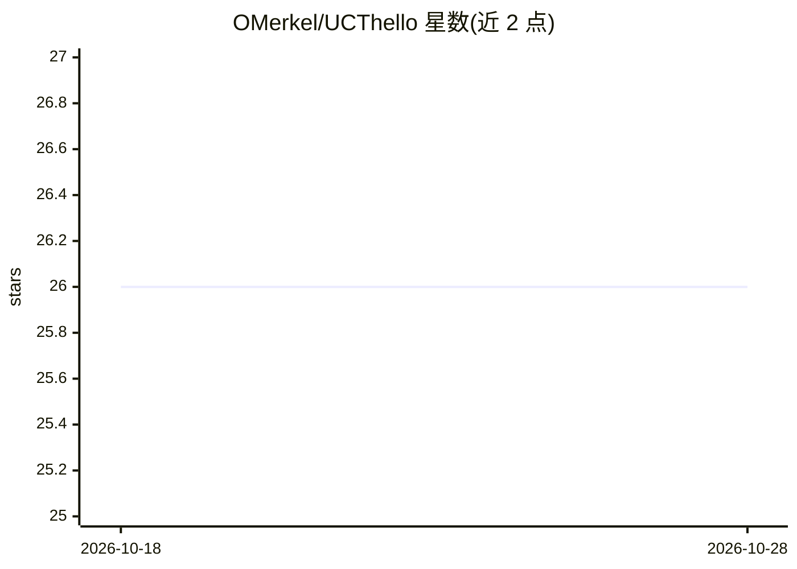

# OMerkel/UCThello

⭐ 26 · JavaScript · NOASSERTION · 推送 2026-10-22 · [GitHub](https://github.com/OMerkel/UCThello) · [官网](http://omerkel.github.io/UCThello/html5/src) · 个人维护

**演示 UCT/MCTS 算法的黑白棋（Othello 变体）网页与安卓游戏**

基于 JavaScript/ECMAScript 的双人棋类游戏，以 Othello（Reversi 衍生）为载体演示 Monte-Carlo Tree Search 与 UCB 结合的 UCT 算法，作为电脑玩家 AI。实现了 MCTS 四阶段（Selection/Expansion/Simulation/Backpropagation），每次迭代单次 playout，优先探索未访问子节点。设计上限定了 AI 响应时间并只用单线程执行 AI 以控制功耗。支持按 WOF 官方规则或变体规则对弈，可在多种桌面与移动浏览器运行，并提供 Android APK 与在线会话。附有架构文档、MCTS 引擎文档、单元与端到端测试。

## 筛选速览

| 维度 | 判定 | 备注 |
|---|---|---|
| AI 角色 | `ai-native` | 本体是模型或模型工具 |
| 许可风险 | `none` | NOASSERTION |
| 部署形态 | `None` |  |
| 模型依赖 | — | README 未给出锁定关系 |
| 硬件要求 | — | 无带数字的原话,不猜 |
| 安装摩擦 | `low` | 无编译、无系统依赖或容器化 |
| 成熟度 | — | 结构信号不足 |

## 能力要点

- 实现 MCTS 四阶段与 UCT 选择策略的电脑玩家 AI
- 支持 WOF 官方 Othello 规则及 Reversi 等变体
- 浏览器（桌面/移动）与 Android APK 多平台运行
- 附软件架构、MCTS 引擎与需求基线文档及测试

## 适用场景

- 在浏览器或手机上与 UCT AI 对弈黑白棋
- 通过实际游戏了解 MCTS/UCT 算法的执行过程
- 参考其 JavaScript 实现与文档学习搜索树算法

## 场景标签

 · 领域:游戏/算法演示

## 证据(README 行号)

> L22: UCThello is a board game using Monte-Carlo Tree Search (MCTS) with
> L24: computer player AI. The board game used for demonstration purposes of

## 星数曲线

2026-10-18 26 → 2026-10-28 26（+0）

---
*卡片 v1 · prompt 1.4 · 生成 2026-10-26 · 置信度 high · 依据 README sha `844443f0a76f` · [字段定义](../../DATASET.md)*
