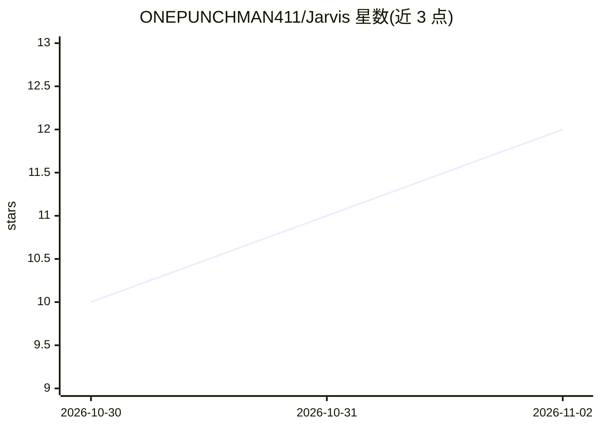

# ONEPUNCHMAN411/Jarvis

⭐ 12 · Python · MIT · 推送 2026-07-07 · [GitHub](https://github.com/ONEPUNCHMAN411/Jarvis) · 个人维护

**Windows 11 语音助手：语音交互并控制桌面与浏览器**

面向 Windows 11 个人用户的语音助手：使用 faster-whisper（CUDA）做语音识别、Silero VAD 做静音门控、Edge TTS 语音回复。通过 Windows UI Automation 无障碍树控制桌面（点击、键盘、拖放、截图、启动应用、音量亮度），并用 Playwright 执行浏览器自动化。内置 50+ 工具与 Gmail/日历等插件，支持 Groq/Gemini/Mistral/OpenAI/Ollama/OpenRouter 多提供商切换与故障回退链，暴露本地 HTTP API。提供约 1.8 GB 安装包（捆绑 CUDA）或源码运行，需自备至少一个提供商 API key。

## 筛选速览

| 维度 | 判定 | 备注 |
|---|---|---|
| AI 角色 | `ai-native` | 本体是模型或模型工具 |
| 许可风险 | `permissive` | MIT |
| 部署形态 | `desktop` | 安装包/桌面程序 |
| 模型依赖 | local-ok | 支持本地模型 |
| 硬件要求 | `gpu-8g` | |
| 安装摩擦 | `medium` | 含编译或系统依赖之一 |
| 成熟度 | — | 结构信号不足 |

## 能力要点

- faster-whisper + Silero VAD 语音识别与 Edge TTS 语音回复
- 经 UI Automation 无障碍树的桌面控制，Playwright 浏览器自动化
- 多提供商路由与健康检查回退链，切换无需重启
- 50+ 内置工具与 Gmail/日历等插件，本地 HTTP API 可编程驱动

## 适用场景

- 用语音指挥电脑完成点击、输入、开应用等桌面操作
- 让助手自动操作真实网页完成浏览器任务
- 本地 API 驱动或扩展自己的工具与插件

## 场景标签

`语音 Agent` `浏览器自动化` `GUI 自动化` · 领域:效率与自动化

## 证据(README 行号)

> L4: Voice assistant for Windows 11. Talks back, controls your desktop, runs real browser automation,, and routes to what
> L40: - Talk to it, it talks back. Uses faster-whisper on CUDA, Edge TTS output, Silero VAD so it doesn't transcribe sile

## 星数曲线

2026-10-30 10 → 2026-11-02 12（+2）

---
*卡片 v1 · prompt 1.4 · 生成 2026-11-02 · 置信度 mid · 依据 README sha `67ef39bcb905` · [字段定义](../../DATASET.md)*
