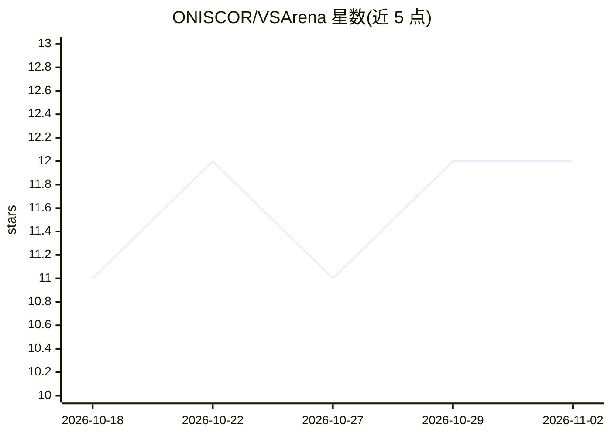

# ONISCOR/VSArena

⭐ 12 · TypeScript · MIT · 推送 2026-10-09 · [GitHub](https://github.com/ONISCOR/VSArena) · [官网](https://vsarena.app) · 个人维护

**VLA 具身策略的公开抓取堆叠评测基准与 ELO 排行榜**

面向空间/VLA（视觉-语言-动作）策略的公开评测产品：单一方块堆叠任务，策略通过 Python SDK 接入官方 harness（Rapier 0.20.0 物理、60Hz、RGB 128×128+指令观测），结果经 SHA-256 摘要与 Ed25519 签名后写入仅官方可更新的公开 ELO 榜。提供浏览器端 Studio 工作单元用于遥操作、演示与调试（不计分）。评测完整性机制包括每周固定采样种子、对照组、动作校验、延迟预算（VLA 2s/5Hz）与失败分类码；声明不保证跨 OS/CPU 的轨迹比特级一致，回放 V1 仅稀疏位姿。本地运行需 Node/Supabase 环境。

## 筛选速览

| 维度 | 判定 | 备注 |
|---|---|---|
| AI 角色 | `ai-ecosystem` | LLM/agent 周边工具 |
| 许可风险 | `permissive` | MIT |
| 部署形态 | `library` | 以包/库形式分发 |
| 模型依赖 | — | README 未给出锁定关系 |
| 硬件要求 | — | 无带数字的原话,不猜 |
| 安装摩擦 | `low` | 无编译、无系统依赖或容器化 |
| 成熟度 | — | 结构信号不足 |

## 能力要点

- Python SDK 接入官方 harness（Rapier 60Hz，RGB+语言观测，无方块位姿）
- 签名结果（SHA-256 摘要 + Ed25519 DSSE）与仅官方可写的公开 ELO 榜
- 评测完整性机制：固定周种子、控制组、动作校验、延迟预算、失败分类码
- 浏览器端 Studio 工作单元支持遥操作/演示/调试（不写 ELO）

## 适用场景

- 评估 VLA 策略在方块堆叠任务上的表现并上榜对比
- 本地调试具身策略（遥操作、Baseline-IK、dry-run）
- 审查评测的可审计性与结果溯源

## 场景标签

`模型评测` · 领域:评测与运维

## 证据(README 行号)

> L5: **The official open benchmark for embodied (VLA) policies.**
> L26: VSArena is a **public evaluation product** for spatial / VLA policies: one stacking task, one wire protocol, one le
> L29:   Policy (Python SDK)  ──state: RGB 128×128 + instruction──►  Harness (Rapier 60 Hz)

## 星数曲线

2026-10-18 11 → 2026-11-02 12（+1）

---
*卡片 v1 · prompt 1.4 · 生成 2026-11-01 · 置信度 mid · 依据 README sha `45b54c2ec27b` · [字段定义](../../DATASET.md)*
