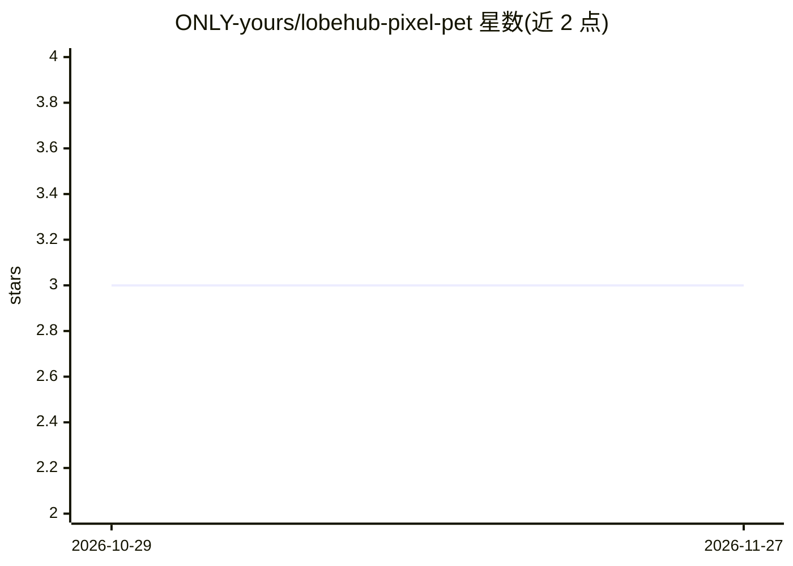

# ONLY-yours/lobehub-pixel-pet

⭐ 3 · JavaScript · MIT · 推送 2026-10-30 · [GitHub](https://github.com/ONLY-yours/lobehub-pixel-pet) · 个人维护 · 中文 README

**以 LobeHub agent 为大脑的像素风桌面宠物**

基于 Electron 的桌面宠物应用，通过 LobeHub CLI（lh）登录并创建专属 agent，将物种性格写入系统角色。宠物有饥饿/疲劳/无聊状态，可成长进化，具备记忆、主动说话、粘贴图片对话（Responses API）功能；可选开启本地工具读取文件和执行命令（无沙箱，README 提示风险）。提供 macOS universal 与 Windows x64 安装包，应用未签名需手动放行；依赖 Node 20+ 与 LobeHub CLI。非官方 LobeHub 产品。

## 筛选速览

| 维度 | 判定 | 备注 |
|---|---|---|
| AI 角色 | `ai-native` | 本体是模型或模型工具 |
| 许可风险 | `permissive` | MIT |
| 部署形态 | `desktop` | 安装包/桌面程序 |
| 模型依赖 | — | README 未给出锁定关系 |
| 硬件要求 | — | 无带数字的原话,不猜 |
| 安装摩擦 | `low` | 无编译、无系统依赖或容器化 |
| 成熟度 | — | 结构信号不足 |

## 能力要点

- 四只初始蛋（火/水/草/大肥鱼），像素精灵由代码生成
- 通过 lh CLI 创建带物种人格的专属 agent，支持图片粘贴/拖入对话（最多 4 张，单张 8MB）
- 本地工具调用可读取文件、按路径检查拖入的文件与文件夹
- 主动说话带冷却与每小时 LLM 调用预算（默认 6），预算用尽时回退到固定台词

## 适用场景

- 在桌面养一只会聊天、会记忆的像素宠物
- 让宠物用本地工具查看拖给它的文件或截图
- 给宠物发图片并围绕图片对话

## 场景标签

`聊天机器人` `AI 助手` · 领域:对话与助手

## 证据(README 行号)

> L3: A pixel-art desktop pet whose brain is a LobeHub agent. It needs a LobeHub account and the LobeHub CLI (`lh`). This 
> L7: 3. The pet lives on your desktop: it gets hungry, tired and bored, evolves (baby → child → adult), remembers what yo
> L17: - **Pictures.** Paste with Ctrl/⌘+V, drag an image onto the window, or use the 📎 button (up to 4 images, 8 MB each)

## 星数曲线

2026-10-29 3 → 2026-11-27 3（+0）

---
*卡片 v1 · prompt 1.4 · 生成 2026-11-22 · 置信度 high · 依据 README sha `2f668f5fea9d` · [字段定义](../../DATASET.md)*
