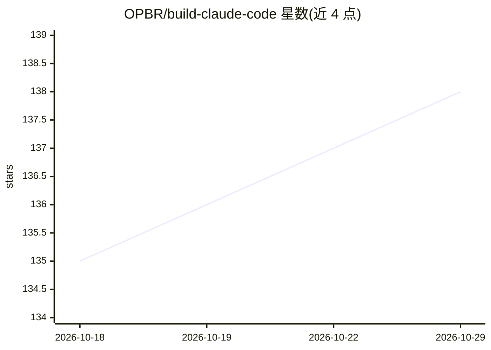

# OPBR/build-claude-code

⭐ 138 · TypeScript · NOASSERTION · 推送 2026-09-20 · [GitHub](https://github.com/OPBR/build-claude-code) · [官网](https://mp.weixin.qq.com/mp/appmsgalbum?__biz=MzU3MDgxMjA2MA==&action=getalbum&album_id=4480744185632391171#wechat_redirect) · 个人维护 · 中文 README

**用 TypeScript 从零构建 Claude Code 式编程代理的渐进教程**

渐进式学习项目：用 TypeScript 重写 Claude Code 的核心机制，按 s01–s21 共 20+ 个 Session 逐步实现 Agent Loop、工具系统、任务规划、上下文压缩、多代理协作、工作树隔离与 MCP 插件等。理念是智能来自模型、Harness 是载体。目前已完成 s01–s14，持续更新中。依赖 Node.js >= 20 与 pnpm，配置 Anthropic API Key 后可逐 Session 运行，灵感来自 learn-claude-code（Python 实现）。

## 筛选速览

| 维度 | 判定 | 备注 |
|---|---|---|
| AI 角色 | `ai-knowledge` | 知识聚合/清单类 |
| 许可风险 | `none` | NOASSERTION |
| 部署形态 | `library` | 以包/库形式分发 |
| 模型依赖 | locked-api |  |
| 硬件要求 | — | 无带数字的原话,不猜 |
| 安装摩擦 | `low` | 无编译、无系统依赖或容器化 |
| 成熟度 | — | 结构信号不足 |

## 能力要点

- s01–s21 渐进式学习路线覆盖 Agent Loop 到 MCP 插件等核心机制
- 使用 TypeScript 重写 Agent 核心逻辑（原参考项目为 Python）
- 基于 @anthropic-ai/sdk 的可运行示例与开发命令

## 适用场景

- 在 Node.js/TypeScript 生态中理解 AI Coding Agent 的工程机制
- 按 Session 逐步学习工具系统、上下文压缩、多代理协作的实现
- 参考源码构建自己的编程代理 Harness

## 场景标签

`教程课程` · 领域:学习与行业

## 证据(README 行号)

> L9: 这是一个**渐进式学习项目**，用 TypeScript 从零开始构建一个完整的 AI 编程代理。我们将逐步实现 Claude Code 的所有核心机制：
> L11: > 本项目灵感来自 learn-claude-code（68.5k ⭐），原项目 Agent 核心由 Python 实现，本项目使用 TypeScript 重写 Agent 逻辑本身，目前已完成 s01–s14，持续更新中。适合希

## 星数曲线

2026-10-18 135 → 2026-10-29 138（+3）

---
*卡片 v1 · prompt 1.4 · 生成 2026-10-22 · 置信度 mid · 依据 README sha `7829a45a2c87` · [字段定义](../../DATASET.md)*
