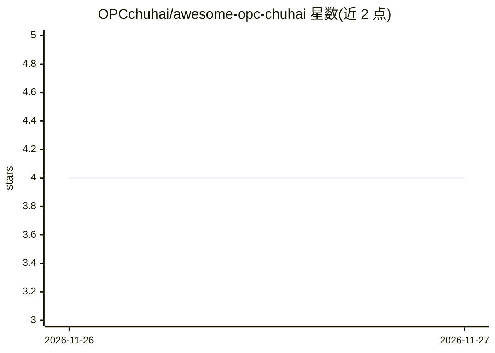

# OPCchuhai/awesome-opc-chuhai

⭐ 4 · CC-BY-4.0 · 推送 2026-11-25 · [GitHub](https://github.com/OPCchuhai/awesome-opc-chuhai) · [官网](https://opcchuhai.com) · 个人维护 · 中文 README

**华人一人公司/独立开发者的 AI 出海资源清单**

由「橙哥出海」维护的策展清单，面向想把 AI 产品卖到海外的华人一人公司与独立开发者。按建议路径组织：一人公司可做的 AI 业务场景、大模型与 API、MCP 规范/客户端/精选服务器、建站托管、跨境收款、公司合规、发布目录、内容获客、开源模板，以及已上线华人 AI 出海产品 Showcase。每条指向官方页面并附适用场景，优先收录免费产品或有公开免费档的产品，声明只整理公开资料、不提供法律税务投资建议。内容以 CC BY 4.0 许可发布，欢迎 Pull Request 补充。

## 筛选速览

| 维度 | 判定 | 备注 |
|---|---|---|
| AI 角色 | `ai-knowledge` | 知识聚合/清单类 |
| 许可风险 | `viral` | CC-BY-4.0 |
| 部署形态 | `None` |  |
| 模型依赖 | — | README 未给出锁定关系 |
| 硬件要求 | — | 无带数字的原话,不猜 |
| 安装摩擦 | `low` | 无编译、无系统依赖或容器化 |
| 成熟度 | — | 结构信号不足 |

## 能力要点

- 按「选形态→接模型→上线收款→发布获客」路径组织条目
- MCP 部分收录规范/SDK、客户端宿主与 11 个官方精选服务器
- 收录华人独立开发者已上线、面向海外收费的 AI 产品 Showcase
- 优先收录免费产品或有公开文档可查的免费档

## 适用场景

- 独立开发者出海前一站式查找模型 API、托管、收款渠道
- 给 Claude/Cursor 等宿主挑选生产级 MCP 服务器
- 参考已上线的华人 AI 出海产品找方向
- 了解设立香港/新加坡/美国主体的官方资料入口

## 场景标签

`精选清单` · 领域:学习与行业

## 证据(README 行号)

> L9: 这是一份写给华人**一人公司 / 独立开发者**的出海清单。重点不是罗列所有 AI 套壳，而是一个人真正能做出来、卖出去的方向：AI SaaS、AI 网站、AI 游戏，以及搭建这些产品会用到的大模型 API、MCP、建站托管、跨境收
> L24: ## 📚 Contents / 目录

## 星数曲线

2026-11-26 4 → 2026-11-27 4（+0）

---
*卡片 v1 · prompt 1.4 · 生成 2026-11-26 · 置信度 mid · 依据 README sha `d63f9a964a50` · [字段定义](../../DATASET.md)*
