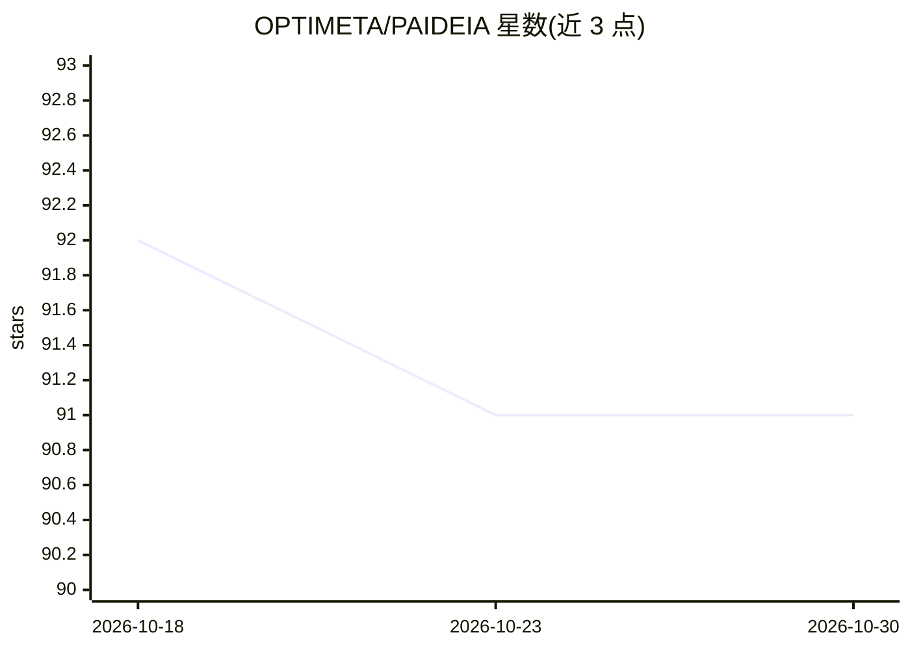

# OPTIMETA/PAIDEIA

⭐ 91 · Python · MIT · 推送 2026-07-11 · [GitHub](https://github.com/OPTIMETA/PAIDEIA) · [官网](https://taewoopark.com/projects/paideia) · 个人维护 · 中文 README

**把个人课程资料转化为本地学习图谱的备考用 Claude Code 插件**

面向数学、物理、工程课程备考学生的 Claude Code 插件：读取用户自己的讲义、教材、作业与手写解答，经 ingest→analyze→drill→grade→weakmap→cheatsheet 六阶段循环，生成可编辑的 markdown 工件（题目树、解题模式卡、考试概率分层、错题日志、速查表）。按作业密度推断考试重点并据此加权出题。OCR 默认走 Claude 视觉，可选本地 Ollama/Qwen3-VL 或 Tesseract；依赖 Claude Code（付费工具），需 Python 3.9+、Unix shell、poppler 与 tesseract，Windows 仅支持 WSL2。

## 筛选速览

| 维度 | 判定 | 备注 |
|---|---|---|
| AI 角色 | `ai-native` | 本体是模型或模型工具 |
| 许可风险 | `permissive` | MIT |
| 部署形态 | `None` |  |
| 模型依赖 | local-ok | 支持本地模型 |
| 硬件要求 | — | 无带数字的原话,不猜 |
| 安装摩擦 | `low` | 无编译、无系统依赖或容器化 |
| 成熟度 | — | 结构信号不足 |

## 能力要点

- 18 个 /paideia: 斜杠命令覆盖摄取→分析→练习→评分→弱点诊断→速查表全流程
- 按 HW 密度分层（Exam-primary/Likely/Possible/Low-risk）加权出题与模拟考
- 所有产物为本地可编辑的 markdown/YAML，含 append-only 错题历史
- OCR 可选 claude 视觉/本地 Ollama Qwen3-VL/Tesseract 三种引擎

## 适用场景

- 用自己教授的讲义和作业构建本课程的备考资料
- 把纸质手写练习拍照 OCR 后获得策略评分与弱点报告
- 考前生成基于自己真实错题的一页速查表

## 场景标签

`OCR` `文档解析` · 领域:知识与检索

## 证据(README 行号)

> L4:  A Claude Code plugin that turns your own materials into a permanent, editable, per-course study graph — every artif
> L52:   ingest ──▶ analyze ──▶ drill ──▶ grade ──▶ weakmap ──▶ cheatsheet
> L127: |**Reflection**|Your hand-written work becomes a grade|`/paideia:grade`|`answers/converted/<name>.md` + `errors/lo

## 星数曲线

2026-10-18 92 → 2026-10-30 91（-1）

---
*卡片 v1 · prompt 1.4 · 生成 2026-10-23 · 置信度 high · 依据 README sha `8c3b2d1f9cb2` · [字段定义](../../DATASET.md)*
