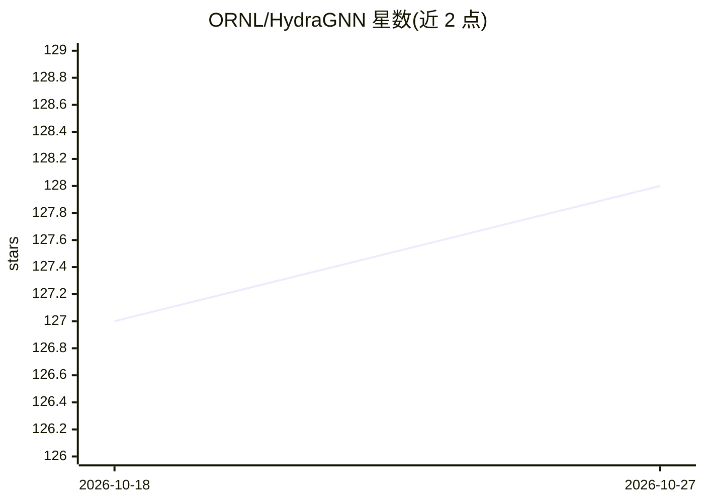

# ORNL/HydraGNN

⭐ 128 · Python · BSD-3-Clause · 推送 2026-10-24 · [GitHub](https://github.com/ORNL/HydraGNN) · 组织维护

**多图多头图神经网络的分布式 PyTorch 框架，面向科学计算**

橡树岭国家实验室（ORNL）维护的 PyTorch 图神经网络库：支持图级与节点级属性的多头预测、DDP/FSDP/DeepSpeed 超算级分布式训练、几何等变卷积（EGNN/PaiNN/MACE 等）、异质图学习、FP32/BF16/FP64 多精度训练，以及能量守恒的机器学习原子间势与最优潮流约束训练。面向材料科学等领域科研用户，通过 JSON 配置文件组织训练，数据集准备由调用方显式负责；需先安装 PyTorch 与 PyTorch Geometric 依赖。

## 筛选速览

| 维度 | 判定 | 备注 |
|---|---|---|
| AI 角色 | `ai-native` | 本体是模型或模型工具 |
| 许可风险 | `permissive` | BSD-3-Clause |
| 部署形态 | `library` | 以包/库形式分发 |
| 模型依赖 | — | README 未给出锁定关系 |
| 硬件要求 | — | 无带数字的原话,不猜 |
| 安装摩擦 | `medium` | 含编译或系统依赖之一 |
| 成熟度 | — | 结构信号不足 |

## 能力要点

- DDP、FSDP（v1/v2）、DeepSpeed 超算级分布式训练
- 等变卷积与预测（EGNN、PaiNN、PNAEq、MACE、DimeNet）
- 同质/异质两类共 20 余种 mpnn_type 可配置
- 能量守恒力的机器学习原子间势与 OPF 约束感知训练

## 适用场景

- 在超算集群上训练材料科学图神经网络代理模型
- 构建能量守恒的机器学习原子间势（MLIP）
- 用异质图建模带类型节点与关系的科学数据

## 场景标签

`科研工具` `模型训练` · 领域:学习与行业

## 证据(README 行号)

> L3: Scalable PyTorch Implementation of Multi-Headed Graph Neural Networks
> L13: - **Multi-headed Prediction** for graph and node-level properties
> L14: - **Distributed Training** via DDP, FSDP (v1/v2), and DeepSpeed at supercomputing scale
> L20: - **Machine-Learned Interatomic Potentials** with energy-conserving forces and energy-derived Hessian supervision

## 星数曲线

2026-10-18 127 → 2026-10-27 128（+1）

---
*卡片 v1 · prompt 1.4 · 生成 2026-10-23 · 置信度 mid · 依据 README sha `105de5326c23` · [字段定义](../../DATASET.md)*
