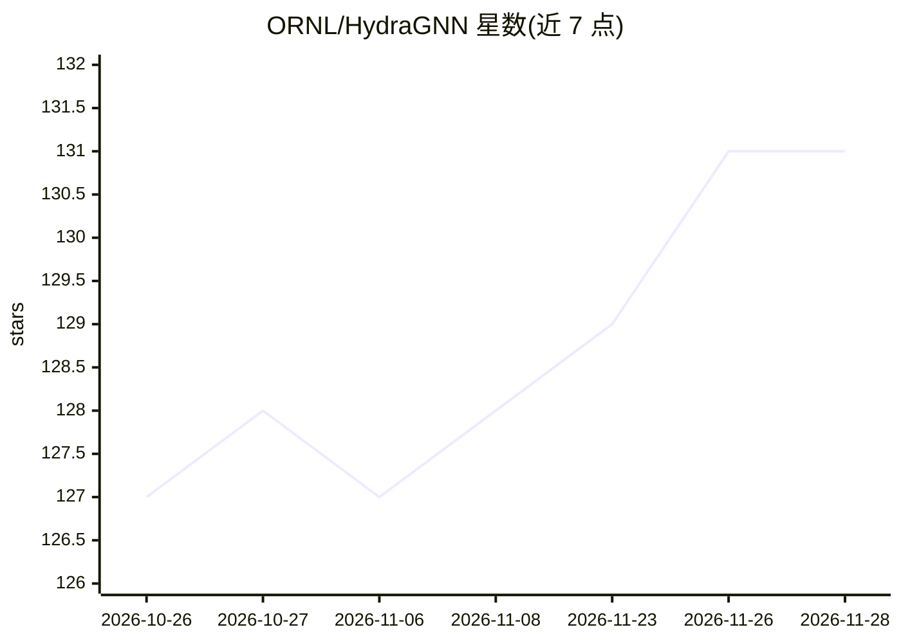

# ORNL/HydraGNN

⭐ 131 · Python · BSD-3-Clause · 推送 2026-11-27 · [GitHub](https://github.com/ORNL/HydraGNN) · 组织维护

**分布式多头图神经网络的 PyTorch 训练库**

橡树岭国家实验室维护的 PyTorch 分布式图神经网络实现：支持图级与节点级多任务预测头、DDP/FSDP/DeepSpeed 超算级分布式训练、多种等变卷积结构（EGNN、PaiNN、MACE、DimeNet 等）与异构图学习，面向材料科学中的机器学习原子间势和最优潮流约束训练等用途。以 Python 包形式安装，通过 JSON 配置文件定义模型与数据集架构，训练/推理编排由调用方显式完成。

## 筛选速览

| 维度 | 判定 | 备注 |
|---|---|---|
| AI 角色 | `ai-native` | 本体是模型或模型工具 |
| 许可风险 | `permissive` | BSD-3-Clause |
| 部署形态 | `library` | 以包/库形式分发 |
| 模型依赖 | — | README 未给出锁定关系 |
| 硬件要求 | — | 无带数字的原话,不猜 |
| 安装摩擦 | `medium` | 含编译或系统依赖之一 |
| 成熟度 | — | 结构信号不足 |

## 能力要点

- DDP、FSDP、DeepSpeed 超算规模分布式训练与多精度（FP32/BF16/FP64）支持
- 多种等变卷积层（EGNN、PaiNN、MACE、DimeNet 等）作为超参数可选
- 能量守恒力的机器学习原子间势与约束感知训练（增广拉格朗日）
- 类型化节点与关系的异构图学习及全局注意力（GPS、等变 Transformer）

## 适用场景

- 在超算集群上分布式训练图神经网络预测材料性质
- 训练带能量守恒力的原子间势模型
- 对图与节点级属性做多任务监督学习

## 场景标签

`模型训练` · 领域:训练与推理

## 证据(README 行号)

> L3: Scalable PyTorch Implementation of Multi-Headed Graph Neural Networks
> L13: - **Multi-headed Prediction** for graph and node-level properties
> L155: 4. Making predictions from a previously trained model:

## 星数曲线

2026-10-26 127 → 2026-11-28 131（+4）

---
*卡片 v1 · prompt 1.4 · 生成 2026-11-28 · 置信度 high · 依据 README sha `6dd7a68014b9` · [字段定义](../../DATASET.md)*
