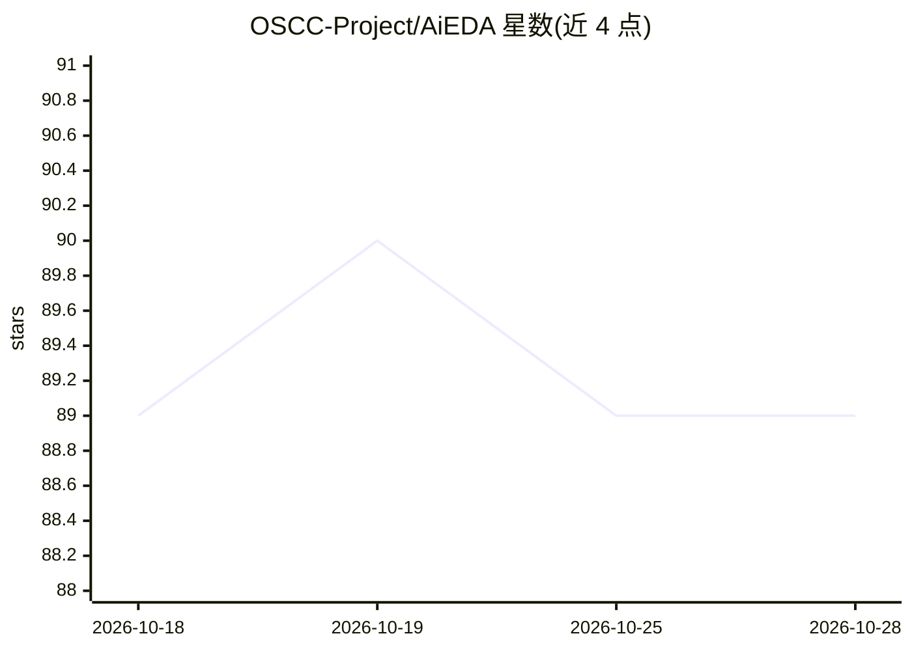

# OSCC-Project/AiEDA

⭐ 89 · Python · MulanPSL-2.0 · 推送 2026-04-02 · [GitHub](https://github.com/OSCC-Project/AiEDA) · 组织维护

**面向芯片设计者的 AI 原生 EDA 库：设计流程执行与设计数据向量化**

Python 库，把工作区管理、EDA 流程编排、工具封装（当前以 iEDA 为主）、设计数据提取与向量化、分析报告及 AI 任务基线整合在一个包内。面向芯片设计自动化研究者与开发者，支持运行物理设计流程、抽取向量化设计数据，并提供建线长/时延/拥塞预测与 DSE 等任务基线。使用前需 git clone 并以 CMake 编译 iEDA Python 原生扩展；当前向量提取与 iEDA 实现耦合，多后端（如 OpenROAD）为规划方向。

## 筛选速览

| 维度 | 判定 | 备注 |
|---|---|---|
| AI 角色 | `ai-ecosystem` | LLM/agent 周边工具 |
| 许可风险 | `viral` | MulanPSL-2.0 |
| 部署形态 | `None` |  |
| 模型依赖 | — | README 未给出锁定关系 |
| 硬件要求 | — | 无带数字的原话,不猜 |
| 安装摩擦 | `medium` | 含编译或系统依赖之一 |
| 成熟度 | — | 结构信号不足 |

## 能力要点

- 以 iEDA 为后端的物理设计流程执行与设计向量提取
- 四层 API：workspace/flows/eda/data-analysis-ai-report
- AI 任务基线：线长、时延、拥塞预测与 DSE 工作流
- 兼作 iDATA 结构化数据集的生成管线

## 适用场景

- 运行 iEDA 物理设计流程并抽取向量化设计数据
- 在标准化 Python API 上构建 AI-EDA 预测与优化任务
- 复现论文实验或开展 AI 辅助芯片设计研究

## 场景标签

`科研工具` · 领域:学习与行业

## 证据(README 行号)

> L17: AiEDA is an AI-native EDA library for running design flows, extracting vectorized design data, and building AI-EDA 
> L29: - AI task baselines for prediction and optimization, including wirelength, delay, congestion, and DSE workflows.

## 星数曲线

2026-10-18 89 → 2026-10-28 89（+0）

---
*卡片 v1 · prompt 1.4 · 生成 2026-10-23 · 置信度 high · 依据 README sha `65813d3fa319` · [字段定义](../../DATASET.md)*
