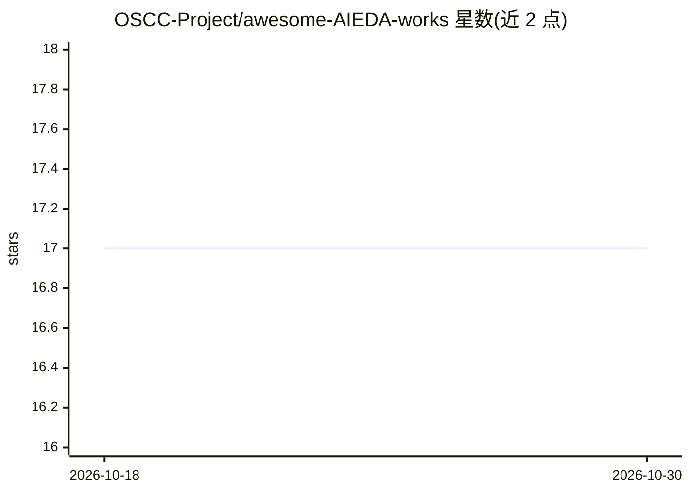

# OSCC-Project/awesome-AIEDA-works

⭐ 17 · 推送 2025-12-03 · [GitHub](https://github.com/OSCC-Project/awesome-AIEDA-works) · 组织维护

**AI for EDA 论文与工具策展清单：覆盖芯片设计自动化研究**

由 OSCC Project 维护的 AI4EDA 主题清单，收录 AI 驱动的 EDA 研究、工具、数据集与框架，按 EDA 基础设施（芯片数据/库/数据集）、逻辑综合（电路分析/优化/工艺映射/精确综合）、验证等章节组织。条目以论文为主，兼含 AiEDA、iEDA、Circuitnet 等开源工具与数据集。物理实现章节标注处于持续扩充中，社区贡献开放。

## 筛选速览

| 维度 | 判定 | 备注 |
|---|---|---|
| AI 角色 | `ai-knowledge` | 知识聚合/清单类 |
| 许可风险 | `none` | — |
| 部署形态 | `None` |  |
| 模型依赖 | — | README 未给出锁定关系 |
| 硬件要求 | — | 无带数字的原话,不猜 |
| 安装摩擦 | `low` | 无编译、无系统依赖或容器化 |
| 成熟度 | `idea` | |

## 能力要点

- 按 EDA 基础设施/逻辑综合/物理实现/验证分章组织
- 收录论文、开源库与数据集三类资源
- 社区维护、开放贡献

## 适用场景

- 查找 AI 用于逻辑综合与电路表示学习的论文
- 寻找 EDA 相关开源数据集与工具库
- 了解 AI4EDA 研究方向的覆盖范围

## 场景标签

`精选清单` · 领域:学习与行业

## 证据(README 行号)

> L15: 🚀 A curated and structured collection of **AI-driven research, tools, datasets, and frameworks** for **Electronic D
> L32: ## **1. AI for EDA Infrastructure**

## 星数曲线

2026-10-18 17 → 2026-10-30 17（+0）

---
*卡片 v1 · prompt 1.4 · 生成 2026-10-30 · 置信度 high · 依据 README sha `d5717ed585db` · [字段定义](../../DATASET.md)*
