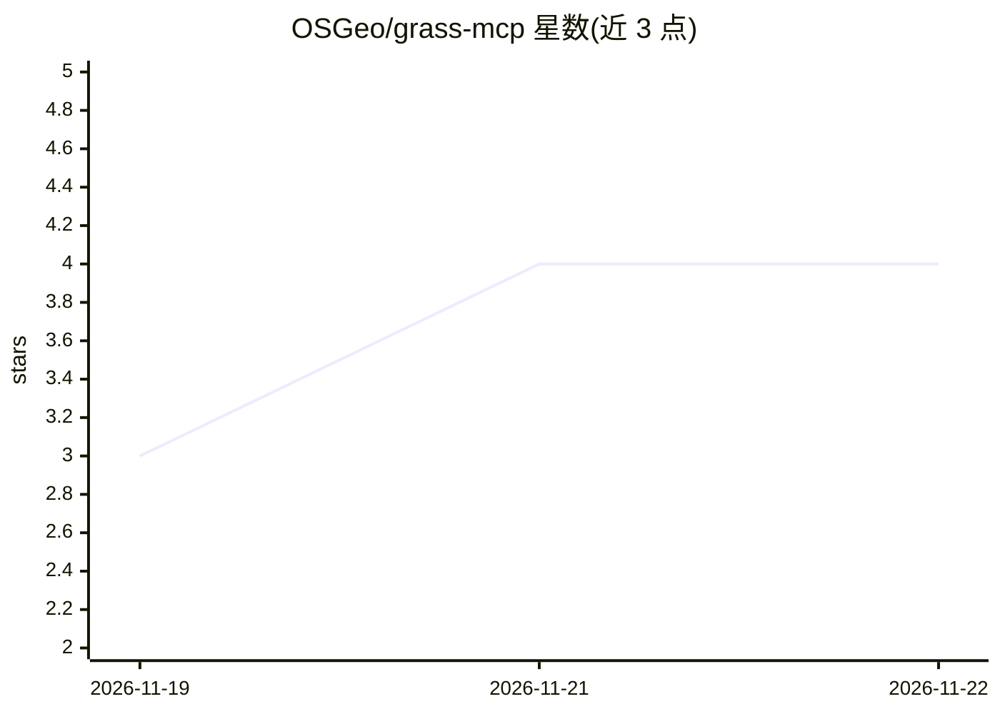

# OSGeo/grass-mcp

⭐ — · [GitHub]() · 组织维护

**让 AI 客户端通过 MCP 调用 GRASS 地理空间处理能力的 server**

一个 Model Context Protocol (MCP) server，面向 GRASS GIS 提供接口，使支持 MCP 的客户端能够调用地理空间栅格、矢量与影像处理能力。README 仅含一行标题与一句描述，安装方式、使用步骤、依赖与许可等信息均未在可见内容中给出，编目依据有限。项目归属 OSGeo 组织下，以 Python 实现为主题标签之一。

## 筛选速览

| 维度 | 判定 | 备注 |
|---|---|---|
| AI 角色 | `ai-ecosystem` | LLM/agent 周边工具 |
| 许可风险 | `viral` | — |
| 部署形态 | `None` |  |
| 模型依赖 | — | README 未给出锁定关系 |
| 硬件要求 | — | 无带数字的原话,不猜 |
| 安装摩擦 | `low` | 无编译、无系统依赖或容器化 |
| 成熟度 | — | 结构信号不足 |

## 能力要点

- 作为 MCP server 暴露 GRASS GIS 能力
- 覆盖地理空间栅格、矢量与影像处理
- 隶属 OSGeo 组织，Python 实现

## 适用场景

- 在支持 MCP 的 AI 客户端中调用 GRASS 地理空间处理功能
- 构建 GIS 相关的 LLM agent 工作流

## 场景标签

 · 领域:地理信息/GIS 工具

## 证据(README 行号)

> L3: Model Context Protocol (MCP) server for GRASS: geospatial raster, vector,
> L4: and imagery processing

## 星数曲线

2026-11-19 3 → 2026-11-22 4（+1）

---
*卡片 v1 · prompt 1.4 · 生成 2026-11-21 · 置信度 mid · 依据 README sha `e89902d7b87f` · [字段定义](../../DATASET.md)*
