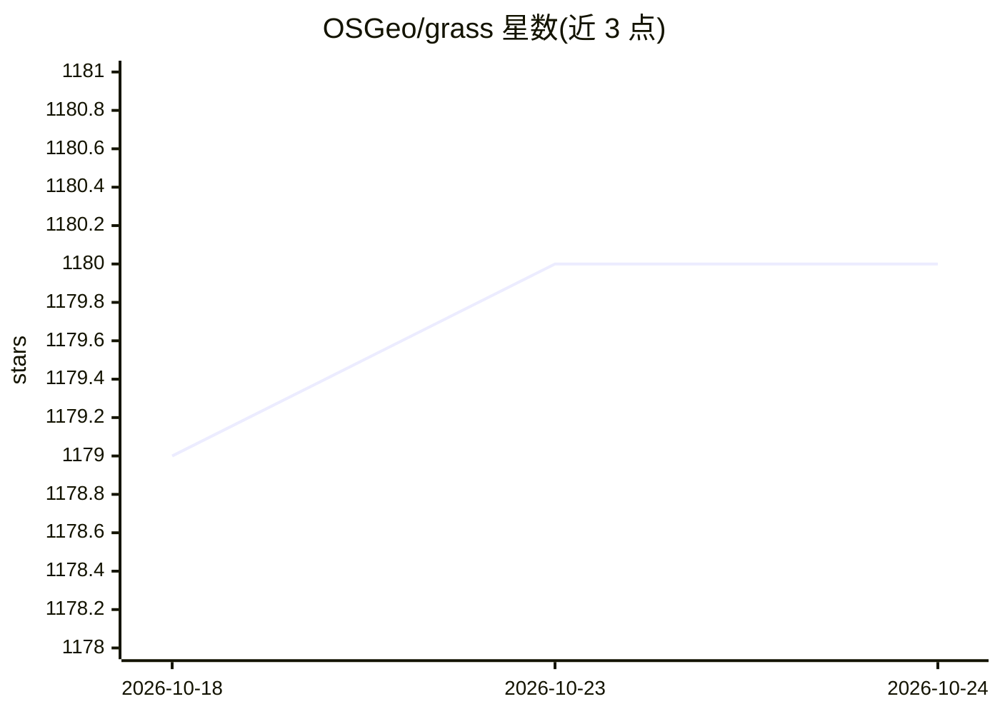

# OSGeo/grass

⭐ 1,180 · C · NOASSERTION · 推送 2026-10-23 · [GitHub](https://github.com/OSGeo/grass) · [官网](https://grass.osgeo.org) · 组织维护

**开源地理空间处理引擎：栅格/矢量分析与GIS桌面及地理处理**

GRASS（Geographic Resources Analysis Support System）是 OSGeo 托管、GPL 许可的地理空间计算引擎，处理栅格、矢量与影像数据，支持地形与生态系统建模、水文分析、数据管理和时间序列分析，提供 Python API、命令行与 R 接口。可作桌面 GIS 使用，也可作为地理处理引擎嵌入其他系统。需从源码编译安装（见 INSTALL.md），并提供 Docker 镜像构建说明。

## 筛选速览

| 维度 | 判定 | 备注 |
|---|---|---|
| AI 角色 | `ai-enhanced` | 去掉 AI 部分产品仍成立 |
| 许可风险 | `none` | NOASSERTION |
| 部署形态 | `None` |  |
| 模型依赖 | — | README 未给出锁定关系 |
| 硬件要求 | — | 无带数字的原话,不猜 |
| 安装摩擦 | `medium` | 含编译或系统依赖之一 |
| 成熟度 | — | 结构信号不足 |

## 能力要点

- 栅格/矢量/影像地理空间处理，含地形与水文建模
- 内建时间框架，支持时间序列分析
- 提供 Python API、命令行与 R 接口
- 可作桌面 GIS 或地理处理引擎使用

## 适用场景

- 在桌面 GIS 中进行地理空间分析与制图
- 用 Python/R 脚本做大规模栅格矢量处理与时间序列分析
- 水文、地形与生态系统建模研究

## 场景标签

`图像视频处理` · 领域:感知与多模态

## 证据(README 行号)

> L22: GRASS, Geographic Resources Analysis Support System,
> L23: is a powerful computational engine for raster, vector, and geospatial processing.
> L24: It supports terrain and ecosystem modeling, hydrology, data management,

## 星数曲线

2026-10-18 1,179 → 2026-10-24 1,180（+1）

---
*卡片 v1 · prompt 1.4 · 生成 2026-10-21 · 置信度 mid · 依据 README sha `6e43c03c3030` · [字段定义](../../DATASET.md)*
