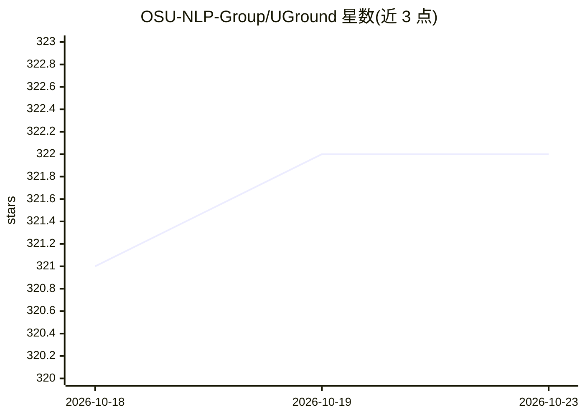

# OSU-NLP-Group/UGround

⭐ 322 · Python · MIT · 推送 2026-08-24 · [GitHub](https://github.com/OSU-NLP-Group/UGround) · [官网](https://osu-nlp-group.github.io/UGround/) · 组织维护

**GUI 智能体的通用视觉定位模型（ICLR'25 Oral）**

OSU NLP Group 与 Orby AI 合作的学术研究成果：训练 GUI 视觉定位（Visual Grounding）模型，给定界面截图与自然语言指令，输出可交互元素的位置。基于 Qwen2-VL 发布 2B/7B/72B 版本，在 ScreenSpot 等基准上给出结果表格。提供模型权重、训练数据（含边界框版）、HF Spaces 在线 Demo 与评测套件，覆盖 ScreenSpot、Multimodal-Mind2Web、AndroidWorld 等离线/在线实验。推理通过 vLLM 服务部署。

## 筛选速览

| 维度 | 判定 | 备注 |
|---|---|---|
| AI 角色 | `ai-native` | 本体是模型或模型工具 |
| 许可风险 | `permissive` | MIT |
| 部署形态 | `library` | 以包/库形式分发 |
| 模型依赖 | local-ok | 支持本地模型 |
| 硬件要求 | — | 无带数字的原话,不猜 |
| 安装摩擦 | `low` | 无编译、无系统依赖或容器化 |
| 成熟度 | — | 结构信号不足 |

## 能力要点

- 基于 Qwen2-VL 发布 2B/7B/72B 模型权重
- 发布训练数据（含边界框版本）与评测套件
- 支持 vLLM 部署推理服务
- 提供 HF Spaces 在线 Demo

## 适用场景

- 为 GUI/Web 智能体提供界面元素视觉定位能力
- 在 ScreenSpot 等基准上评测定位模型
- 复现论文训练与离线/在线实验

## 场景标签

`多模态` `模型评测` · 领域:评测与运维

## 证据(README 行号)

> L2: This is the official code repository for the project: *Navigating the Digital World as Humans Do: Universal Visual G
> L114: vllm serve osunlp/UGround-V1-7B  --api-key token-abc123 --dtype float16

## 星数曲线

2026-10-18 321 → 2026-10-23 322（+1）

---
*卡片 v1 · prompt 1.4 · 生成 2026-10-21 · 置信度 high · 依据 README sha `5929f2ccef93` · [字段定义](../../DATASET.md)*
