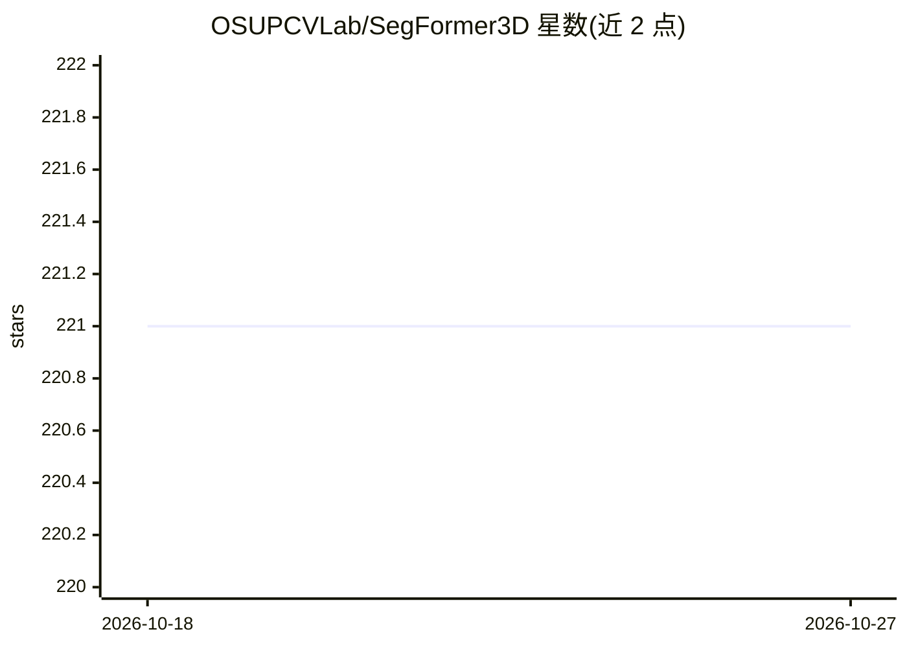

# OSUPCVLab/SegFormer3D

⭐ 221 · Python · GPL-3.0 · 推送 2026-03-21 · [GitHub](https://github.com/OSUPCVLab/SegFormer3D) · [官网](https://osupcvlab.github.io/SegFormer3D/) · 组织维护

**CVPR 2024 论文官方实现：3D 医学图像分割 Transformer 架构**

SegFormer3D 的官方 PyTorch 实现，发表于 CVPR 2024 DEF-AI-MIA workshop。架构为轻量分层 Transformer，跨多尺度体数据计算注意力，使用全 MLP 解码器聚合局部与全局注意力特征生成分割掩码。README 提供基于 conda 的源码安装流程与 BraTS2017 的分步训练指南（含数据预处理、kfold 划分、accelerate 单 GPU 启动、wandb 日志），并提供 BraTS2017 训练权重下载。局限：ACDC/Synapse 数据处理依赖 nnFormer 仓库流程，无独立简化指南；其他数据集指南标注 coming soon。

## 筛选速览

| 维度 | 判定 | 备注 |
|---|---|---|
| AI 角色 | `ai-native` | 本体是模型或模型工具 |
| 许可风险 | `viral` | GPL-3.0 |
| 部署形态 | `None` |  |
| 模型依赖 | — | README 未给出锁定关系 |
| 硬件要求 | — | 无带数字的原话,不猜 |
| 安装摩擦 | `medium` | 含编译或系统依赖之一 |
| 成熟度 | — | 结构信号不足 |

## 能力要点

- 分层 Transformer + 全 MLP 解码器的 3D 体数据分割架构
- 提供 BraTS2017 完整训练流程与预训练权重下载
- 支持 kfold 数据划分与 wandb 实验日志
- 在 Synapse/BraTS2017/ACDC 三个数据集上与 nnFormer、UNETR 等模型做了 Dice 基准对比

## 适用场景

- 我想在自己的 BraTS2017/2021 MRI 数据上训练 3D 分割模型
- 我需要复现论文中 Synapse/ACDC/BraTS 的分割结果
- 我想把 SegFormer3D 作为 3D 医学图像分割的 baseline 架构

## 场景标签

`目标检测` · 领域:感知与多模态

## 证据(README 行号)

> L7: Segformer3D is a light-weight and efficient hierarchical Transformer designed for 3D volumetric segmentation. It cal
> L2: ## An Efficient Transformer for 3D Medical Image Segmentation

## 星数曲线

2026-10-18 221 → 2026-10-27 221（+0）

---
*卡片 v1 · prompt 1.4 · 生成 2026-10-22 · 置信度 high · 依据 README sha `55a03b7574d8` · [字段定义](../../DATASET.md)*
