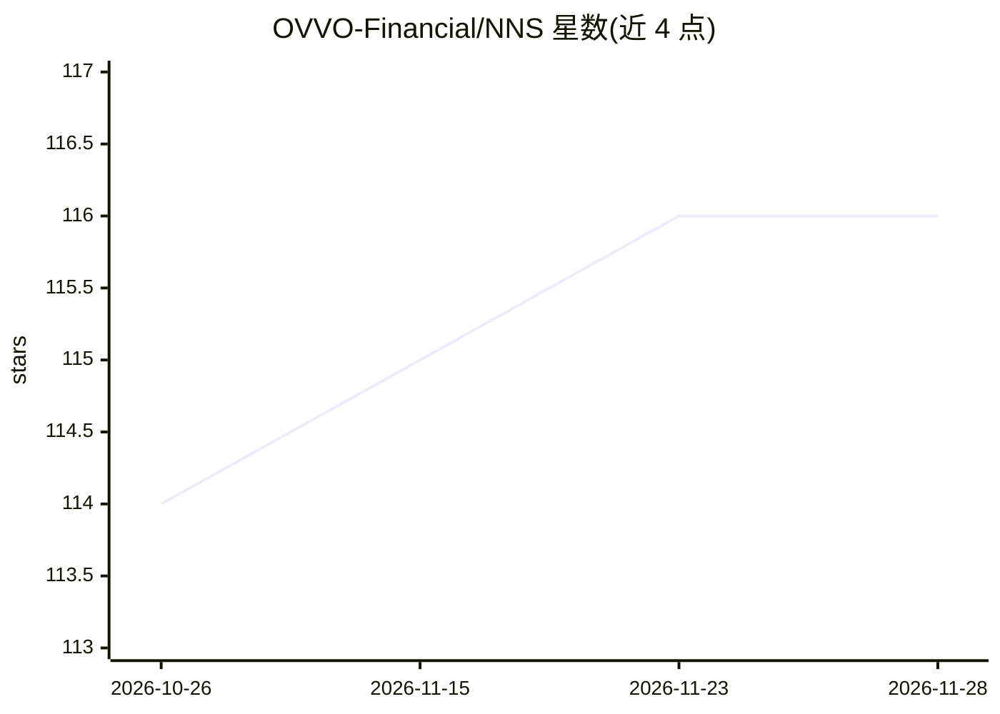

# OVVO-Financial/NNS

⭐ 116 · Lean · 推送 2026-11-21 · [GitHub](https://github.com/OVVO-Financial/NNS) · [官网](https://github.com/OVVO-Financial/NNS/blob/NNS-Beta-Version/examples/index.md) · 组织维护

**基于偏矩的非线性非参数统计 R 包**

以偏矩（方差的组成元素，可渐近逼近 f(x) 下面积）为基础的 R 统计包，面向不满足对称性、线性或分布假设的真实数据。功能覆盖数值积分与微分、聚类、非线性相关与因果分析、回归与分类、ANOVA、季节性与自回归建模、蒙特卡洛采样等。配套书籍（2013 年及第二版在线版）、分章视频、示例页与 Lean 4 形式化证明，通过 CRAN 或 GitHub 安装。

## 筛选速览

| 维度 | 判定 | 备注 |
|---|---|---|
| AI 角色 | `ai-native` | 本体是模型或模型工具 |
| 许可风险 | `none` | — |
| 部署形态 | `None` |  |
| 模型依赖 | — | README 未给出锁定关系 |
| 硬件要求 | — | 无带数字的原话,不猜 |
| 安装摩擦 | `low` | 无编译、无系统依赖或容器化 |
| 成熟度 | — | 结构信号不足 |

## 能力要点

- 提供非线性回归、分类、聚类、因果分析等统计方法
- 配套书籍与分章教学视频
- 数学命题在 Lean 4 中形式化
- CRAN 与 GitHub 双安装渠道

## 适用场景

- 对不满足线性或分布假设的数据做非线性回归与分类
- 计量经济学中的相关性与因果分析
- 时间序列的季节性与自回归建模

## 场景标签

 · 领域:统计学/计量经济学

## 证据(README 行号)

> L11:  - Nonlinear Regression & Classification
> L4: NNS (Nonlinear Nonparametric Statistics) leverages partial moments – the fundamental elements of variance that asymp

## 星数曲线

2026-10-26 114 → 2026-11-28 116（+2）

---
*卡片 v1 · prompt 1.4 · 生成 2026-11-28 · 置信度 mid · 依据 README sha `bf672c044186` · [字段定义](../../DATASET.md)*
