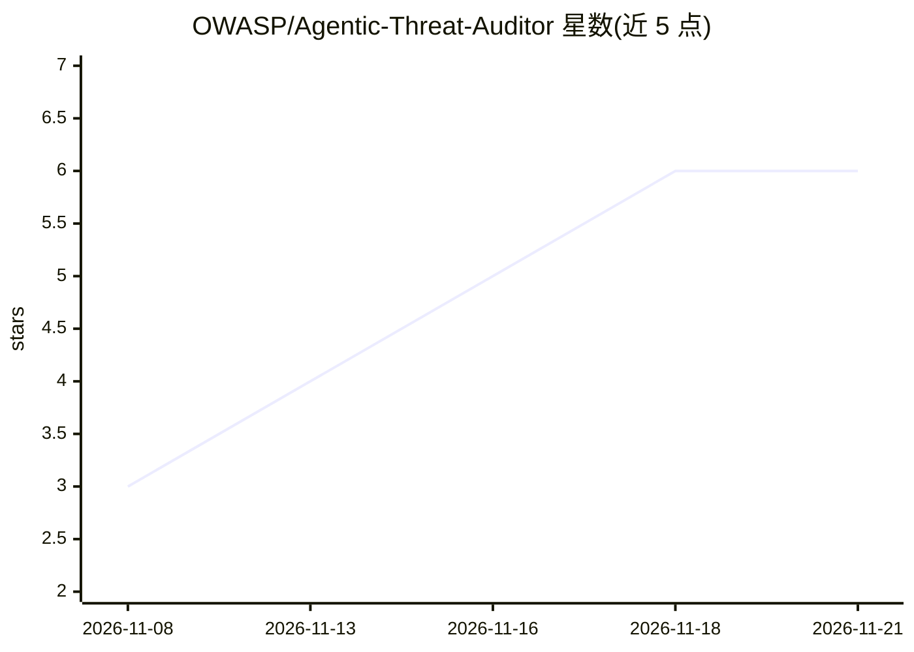

# OWASP/Agentic-Threat-Auditor

⭐ 6 · Python · Apache-2.0 · 推送 2026-11-04 · [GitHub](https://github.com/OWASP/Agentic-Threat-Auditor) · [官网](https://owasp.org/projects/agentic-threat-auditor) · 组织维护

**多跳 AI Agent 的动态渗透测试与越权审计工具**

OWASP 孵化器项目，面向 LangChain/LangGraph/CrewAI/AutoGen/MCP 生态的自主 Agent 审计工具包，针对 OWASP LLM08（过度代理）、参数注入与跨 Agent 委托提权等向量动态测试运行时中间件。提供 CLI（oata），支持内置 mock agent 本地演示、payload 清单查看、本地端点与离线 trace JSON 审计，结果可输出终端表格、JSON 与 SARIF v2.1.0。默认仅限 localhost 与本地 mock 环境，路线图显示多框架适配器与 Docker 分发尚在计划阶段，当前为 v0.1-Alpha。

## 筛选速览

| 维度 | 判定 | 备注 |
|---|---|---|
| AI 角色 | `ai-ecosystem` | LLM/agent 周边工具 |
| 许可风险 | `permissive` | Apache-2.0 |
| 部署形态 | `library` | 以包/库形式分发 |
| 模型依赖 | — | README 未给出锁定关系 |
| 硬件要求 | — | 无带数字的原话,不猜 |
| 安装摩擦 | `low` | 无编译、无系统依赖或容器化 |
| 成熟度 | `idea` | |

## 能力要点

- 针对 LLM08 等 5 类攻击向量（AT-01~AT-05）的动态中间件 fuzzing
- 原生框架适配器定位：LangChain、LangGraph、CrewAI、AutoGen、MCP
- 结果输出 SARIF v2.1.0，可接入 GitHub Code Scanning
- 默认 Safe Local Target Guard，限定 localhost 与本地 mock 环境

## 适用场景

- 上线前对 Agent 工具调用边界做基线渗透扫描
- 将审计结果接入 CI/CD 安全门禁与 SARIF 报告
- 把审计发现映射到 OWASP LLM08、NIST AI RMF 等合规框架

## 场景标签

`网络安全` · 领域:学习与行业

## 证据(README 行号)

> L28: The **OWASP Agentic Threat Auditor (OATA)** is an open-source, dynamic penetration testing and red teaming toolkit 
> L36: - **🧩 Pluggable Framework Adapters**: Native drivers for LangChain, LangGraph, CrewAI, AutoGen, and Model Context P

## 星数曲线

2026-11-08 3 → 2026-11-21 6（+3）

---
*卡片 v1 · prompt 1.4 · 生成 2026-11-20 · 置信度 high · 依据 README sha `a8ed6f59a466` · [字段定义](../../DATASET.md)*
