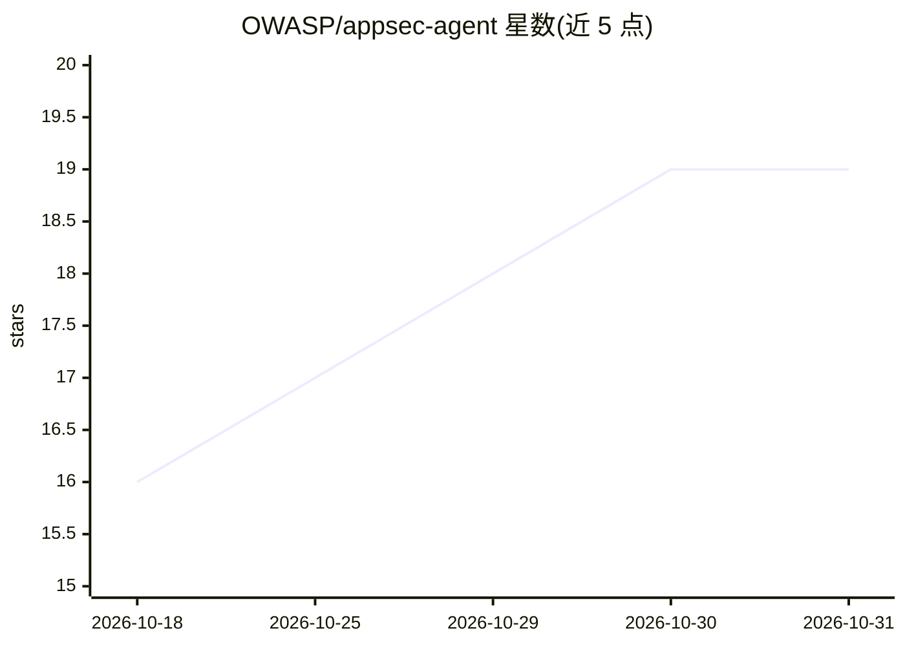

# OWASP/appsec-agent

⭐ 19 · TypeScript · Apache-2.0 · 推送 2026-08-21 · [GitHub](https://github.com/OWASP/appsec-agent) · [官网](https://owasp.org/appsec-agent/) · 组织维护

**OWASP 维护的应用安全 AI Agent 工具：代码审查与威胁建模**

TypeScript/npm 包，提供面向应用安全（AppSec）任务的 AI agent：全仓库安全审查、PR diff 扫描、STRIDE 威胁建模、修复生成、QA 验证与误报过滤等 12 种角色。模型后端在运行时可选：Claude（默认）、Codex（OpenAI）、DeepInfra（托管 Kimi/DeepSeek/GLM/Qwen 开放权重模型），支持 MCP 工具与结构化 JSON 输出，可作 CLI（agent-run）、npm 库或配合配套 Web 应用（AI Threat Modeler）使用。需 Node.js 18+ 与模型 API key。

## 筛选速览

| 维度 | 判定 | 备注 |
|---|---|---|
| AI 角色 | `ai-native` | 本体是模型或模型工具 |
| 许可风险 | `permissive` | Apache-2.0 |
| 部署形态 | `self-host` | docker 或自建部署 |
| 模型依赖 | locked-api |  |
| 硬件要求 | — | 无带数字的原话,不猜 |
| 安装摩擦 | `low` | 无编译、无系统依赖或容器化 |
| 成熟度 | — | 结构信号不足 |

## 能力要点

- 12 种专门化 agent 角色：代码审查、PR 扫描、STRIDE 威胁建模、修复生成、QA 验证、误报过滤等
- 三种模型后端运行时切换：Claude（默认）/ Codex（OpenAI）/ DeepInfra，支持 MCP 与结构化 JSON 输出
- 提供 CLI、npm 库两种使用方式，另有配套 Docker 化 Web 应用 AI Threat Modeler
- 库层面线程安全设计，可嵌入 Web 服务器

## 适用场景

- 对仓库或 PR 做安全审查并输出 markdown/JSON 报告
- 生成 STRIDE 威胁模型与风险登记表
- 对安全发现做二次对抗验证、误报过滤与最小修复生成
- 把安全 agent 能力嵌入自己的流水线或 Web 服务

## 场景标签

`代码审查` `网络安全` · 领域:编码与开发

## 证据(README 行号)

> L3: AI-powered security agents for code review, PR scanning, threat modeling, fix generation, and more.
> L61: |`code_reviewer`|Full-repo security review; markdown or JSON report|
> L82: |**Claude** (default)|`--provider claude`|`ANTHROPIC_API_KEY`|`sonnet`, `opus`, `haiku`, `claude-sonnet-4-6`|

## 星数曲线

2026-10-18 16 → 2026-10-31 19（+3）

---
*卡片 v1 · prompt 1.4 · 生成 2026-10-29 · 置信度 mid · 依据 README sha `312d8f54882a` · [字段定义](../../DATASET.md)*
