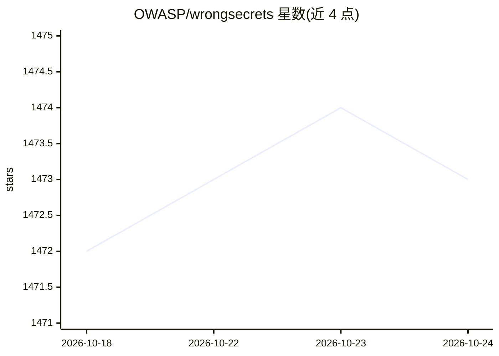

# OWASP/wrongsecrets

⭐ 1,473 · HTML · AGPL-3.0 · 推送 2026-10-23 · [GitHub](https://github.com/OWASP/wrongsecrets) · [官网](https://owasp.org/www-project-wrongsecrets/) · 组织维护

**OWASP 安全培训游戏：通过闯关学习密钥管理错误**

OWASP 生产级项目，一款故意包含漏洞的应用：在代码、配置文件、Docker 容器、Kubernetes 与 AWS/GCP/Azure 云部署中藏入真实与虚假密钥，用户通过 0-74 号挑战逐一找出并学习常见的密钥暴露方式。提供 Heroku/Render 在线演示、Docker 一键运行、Minikube+Vault 以及云环境等多种部署路径，可用于 CTF 与工作坊。含 MCP 服务器相关挑战（8090 端口、Google Drive MCP 挑战 62）。

## 筛选速览

| 维度 | 判定 | 备注 |
|---|---|---|
| AI 角色 | `ai-enhanced` | 去掉 AI 部分产品仍成立 |
| 许可风险 | `viral` | AGPL-3.0 |
| 部署形态 | `self-host` | docker 或自建部署 |
| 模型依赖 | — | README 未给出锁定关系 |
| 硬件要求 | — | 无带数字的原话,不猜 |
| 安装摩擦 | `low` | 无编译、无系统依赖或容器化 |
| 成熟度 | — | 结构信号不足 |

## 能力要点

- 0-74 号密钥暴露挑战，覆盖代码/配置/容器/K8s/云多场景
- Docker 一键运行与 Heroku/Render/Railway 托管选项
- Minikube + HashiCorp Vault 与 AWS/GCP/Azure 云挑战路径
- 含 MCP 服务器挑战（8090 端口）与 Google Drive MCP 挑战

## 适用场景

- 安全团队以 CTF 或工作坊形式培训密钥管理意识
- 开发者在本地 Docker 环境练习密钥检测工具与技术
- 学习 Kubernetes 与云环境下的密钥安全实践

## 场景标签

`网络安全` · 领域:学习与行业

## 证据(README 行号)

> L15: Welcome to the OWASP WrongSecrets game! The game is packed with real life examples of how to _not_ store secrets in
> L127: - Port **8080**: Main application (challenges 0-73)
> L130: **📝 Note on Challenge 62 (Google Drive MCP):**

## 星数曲线

2026-10-18 1,472 → 2026-10-24 1,473（+1）

---
*卡片 v1 · prompt 1.4 · 生成 2026-10-21 · 置信度 low · 依据 README sha `c755f4272287` · [字段定义](../../DATASET.md)*
