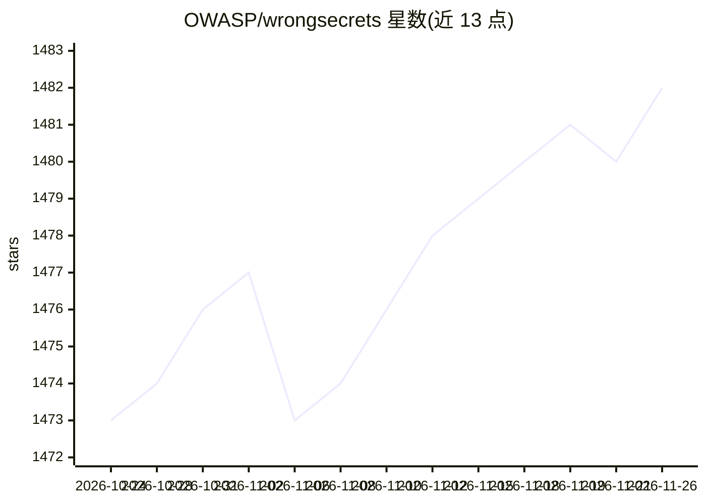

# OWASP/wrongsecrets

⭐ 1,482 · HTML · AGPL-3.0 · 推送 2026-11-25 · [GitHub](https://github.com/OWASP/wrongsecrets) · [官网](https://owasp.org/www-project-wrongsecrets/) · 组织维护

**密钥泄露安全练习游戏：学习如何不存储 secrets**

OWASP 旗下的安全练习应用，内含一系列挑战（challenge），每项展示一种错误的 secrets 存储方式，需用工具与技巧找出代码、配置、容器或云部署中隐藏的密钥。提供 Docker 本地运行、Heroku/Render/Railway 在线演示、Minikube/K8s/Vault 进阶练习，以及 AWS/GCP/Azure 云挑战；支持自定义挑战集用于 workshop/CTF。基于 Java/Spring Boot，运行 8080 端口，8090 端口提供 MCP 服务器供挑战 60 使用。

## 筛选速览

| 维度 | 判定 | 备注 |
|---|---|---|
| AI 角色 | `ai-enhanced` | 去掉 AI 部分产品仍成立 |
| 许可风险 | `viral` | AGPL-3.0 |
| 部署形态 | `self-host` | docker 或自建部署 |
| 模型依赖 | — | README 未给出锁定关系 |
| 硬件要求 | — | 无带数字的原话,不猜 |
| 安装摩擦 | `low` | 无编译、无系统依赖或容器化 |
| 成熟度 | — | 结构信号不足 |

## 能力要点

- 真实代码与配置中隐藏真实/虚假 secrets 的挑战集
- Docker/K8s/Vault/AWS/GCP/Azure 多层部署练习路径
- Heroku 在线演示环境可直接体验
- 支持自定义挑战集用于 workshop 与 CTF

## 适用场景

- 自测并反思自己项目的 secrets 管理策略
- 组织安全培训或 CTF 比赛活动
- 学习 Kubernetes 与 Vault 中的密钥管理实践
- 体验云环境下的密钥泄露与检测场景

## 场景标签

`网络安全` · 领域:学习与行业

## 证据(README 行号)

> L15: Welcome to the OWASP WrongSecrets game! The game is packed with real life examples of how to _not_ store secrets in
> L47: This repository contains **intentionally vulnerable code and configuration files** with real and fake secrets hidde

## 星数曲线

2026-10-24 1,473 → 2026-11-26 1,482（+9）

---
*卡片 v1 · prompt 1.4 · 生成 2026-11-23 · 置信度 mid · 依据 README sha `bf54b44b7e2d` · [字段定义](../../DATASET.md)*
