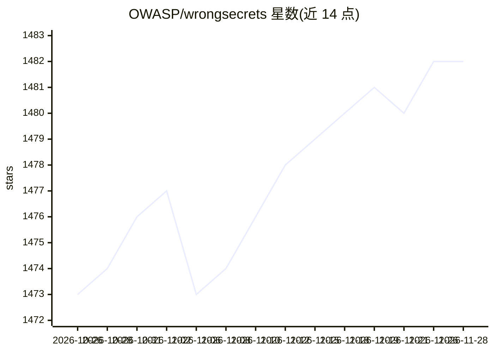

# OWASP/wrongsecrets

⭐ 1,482 · HTML · AGPL-3.0 · 推送 2026-11-25 · [GitHub](https://github.com/OWASP/wrongsecrets) · [官网](https://owasp.org/www-project-wrongsecrets/) · 组织维护

**面向开发者的密钥存储错误用法挑战游戏与安全训练应用**

OWASP 旗下的密钥安全教学游戏：仓库内置故意暴露的代码与配置文件，将真实与伪造的密钥隐藏其中，参与者通过工具与技术逐题破解挑战，从而识别常见的密钥管理错误并反思自身策略。挑战按部署层级组织：Docker 基础题、Kubernetes/Minikube 题、AWS/GCP/Azure 云题，可定制题目集用于 CTF 与培训；支持 Heroku/Render/Railway/Fly/Vercel 托管部署，8090 端口提供 MCP server 供挑战 60 使用。

## 筛选速览

| 维度 | 判定 | 备注 |
|---|---|---|
| AI 角色 | `ai-enhanced` | 去掉 AI 部分产品仍成立 |
| 许可风险 | `viral` | AGPL-3.0 |
| 部署形态 | `self-host` | docker 或自建部署 |
| 模型依赖 | — | README 未给出锁定关系 |
| 硬件要求 | — | 无带数字的原话,不猜 |
| 安装摩擦 | `low` | 无编译、无系统依赖或容器化 |
| 成熟度 | — | 结构信号不足 |

## 能力要点

- 内嵌故意漏洞的代码与配置，挑战形式覆盖 70+ 道题
- 分层部署路径：Docker、Kubernetes/Minikube、云（AWS/GCP/Azure）
- 可定制挑战集用于 workshop 与 CTF
- 8090 端口提供 MCP server（挑战 60 需要）

## 适用场景

- 本地用 Docker 起环境练习发现暴露的密钥
- 在 Minikube 上学习 Kubernetes secrets 的错误用法
- 组织安全培训或 CTF 并定制挑战集

## 场景标签

`网络安全` · 领域:学习与行业

## 证据(README 行号)

> L15: Welcome to the OWASP WrongSecrets game! The game is packed with real life examples of how to _not_ store secrets in
> L127: - Port **8080**: Main application (challenges 0-73)
> L255: **Important:** WrongSecrets is intentionally vulnerable and contains

## 星数曲线

2026-10-26 1,473 → 2026-11-28 1,482（+9）

---
*卡片 v1 · prompt 1.4 · 生成 2026-11-26 · 置信度 mid · 依据 README sha `904d3d24d8a3` · [字段定义](../../DATASET.md)*
