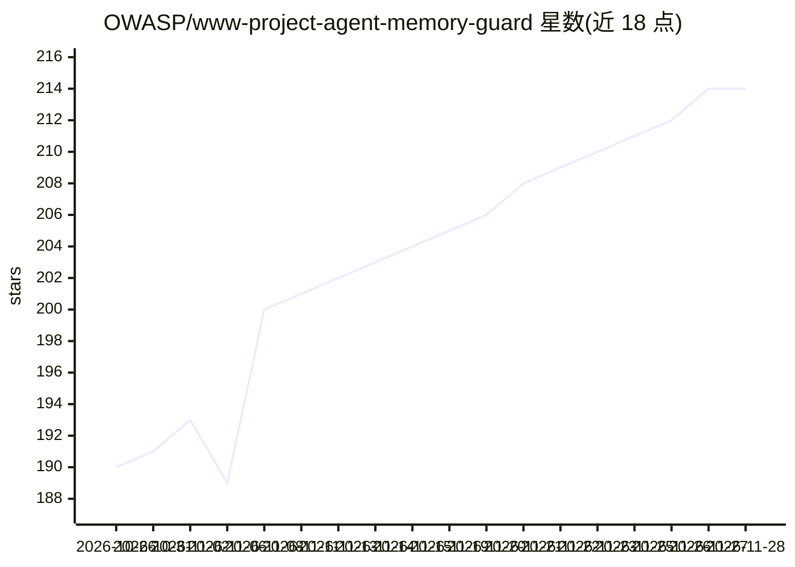

# OWASP/www-project-agent-memory-guard

⭐ 214 · Python · Apache-2.0 · 推送 2026-11-27 · [GitHub](https://github.com/OWASP/www-project-agent-memory-guard) · [官网](https://owasp.org/projects/agent-memory-guard) · 组织维护

**给 AI agent 的记忆投毒运行时防御库（OWASP ASI06）**

OWASP 官方 Lab 项目，作为 ASI06（Memory & Context Poisoning）的参考实现，在 agent 与其记忆存储之间拦截每次读写操作：内置 prompt 注入、敏感数据泄露、受保护键篡改、尺寸异常与自我强化循环检测器，配合 YAML 声明式策略执行 allow/redact/quarantine/block 动作。本地运行、无需 API key，中位延迟 62 µs；每个决策输出结构化 SecurityEvent，支持快照回滚、来源分类溯源与 OpenTelemetry 导出。提供 LangChain 中间件、OpenAI Agents/AutoGen/mem0/CrewAI 集成示例，以及独立的记忆系统安全基准 amg-bench。

## 筛选速览

| 维度 | 判定 | 备注 |
|---|---|---|
| AI 角色 | `ai-ecosystem` | LLM/agent 周边工具 |
| 许可风险 | `permissive` | Apache-2.0 |
| 部署形态 | `library` | 以包/库形式分发 |
| 模型依赖 | — | README 未给出锁定关系 |
| 硬件要求 | — | 无带数字的原话,不猜 |
| 安装摩擦 | `low` | 无编译、无系统依赖或容器化 |
| 成熟度 | — | 结构信号不足 |

## 能力要点

- 运行时拦截 agent 记忆读写，检测可跨上下文重置存活的投毒
- 内置 5 类检测器 + YAML 策略（allow/redact/quarantine/block）
- 为 LangChain 提供 GuardedChatMessageHistory 与中间件包，覆盖 OpenAI Agents/AutoGen/mem0/CrewAI 集成示例
- 附带框架无关的 AMSB 基准（amg-bench）可给任意记忆系统评分

## 适用场景

- 为持久化记忆的 agent 加上记忆写入/读取安全筛查
- 按 NIST AI RMF / EU AI Act 映射落地 agent 记忆治理
- 用 amg-bench 评估自建记忆系统对投毒攻击的韧性

## 场景标签

`网络安全` · 领域:学习与行业

## 证据(README 行号)

> L83: Agent Memory Guard sits between the agent and its memory store, screening every operation through a pipeline of det
> L149: - **Drop-in middleware** — ships with `GuardedChatMessageHistory` for LangChain; framework-agnostic `MemoryStore` 

## 星数曲线

2026-10-26 190 → 2026-11-28 214（+24）

---
*卡片 v1 · prompt 1.4 · 生成 2026-11-28 · 置信度 high · 依据 README sha `cfa3295095fd` · [字段定义](../../DATASET.md)*
