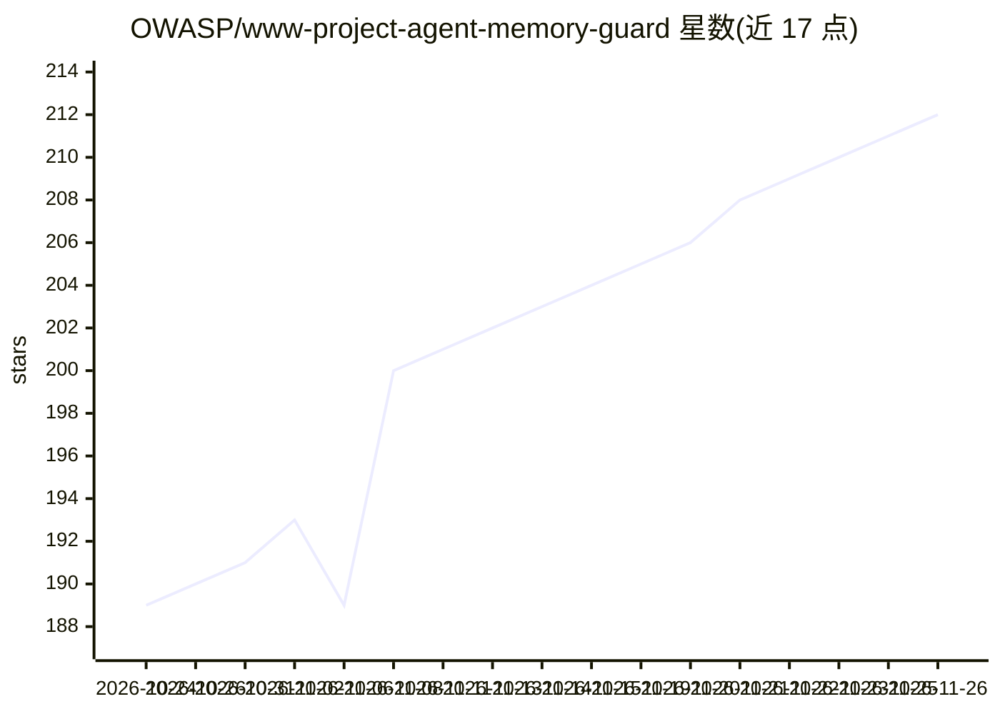

# OWASP/www-project-agent-memory-guard

⭐ 212 · Python · Apache-2.0 · 推送 2026-11-25 · [GitHub](https://github.com/OWASP/www-project-agent-memory-guard) · [官网](https://owasp.org/projects/agent-memory-guard) · 组织维护

**为 AI agent 记忆存储提供运行时防投毒防护的安全中间件**

面向 AI agent 的记忆投毒运行时防御库（OWASP ASI06 参考实现）：在 agent 与其记忆存储之间筛查每次读写，内置提示注入、敏感数据泄漏、受保护键篡改、尺寸异常与自我强化循环检测器，配合 YAML 声明式策略输出 allow/redact/quarantine/block 动作；每次决策产生结构化 SecurityEvent 支持取证回滚。无需 API key、本地运行，附带 55 例基准与 amg-bench 评分工具，支持 SIEM 关联与 OpenTelemetry 导出。

## 筛选速览

| 维度 | 判定 | 备注 |
|---|---|---|
| AI 角色 | `ai-ecosystem` | LLM/agent 周边工具 |
| 许可风险 | `permissive` | Apache-2.0 |
| 部署形态 | `library` | 以包/库形式分发 |
| 模型依赖 | — | README 未给出锁定关系 |
| 硬件要求 | — | 无带数字的原话,不猜 |
| 安装摩擦 | `low` | 无编译、无系统依赖或容器化 |
| 成熟度 | — | 结构信号不足 |

## 能力要点

- 内置提示注入、PII 泄漏、受保护键篡改、尺寸异常、自我强化循环检测器
- YAML 声明式策略映射到 allow/redact/quarantine/block 动作
- 提供 LangChain GuardedChatMessageHistory 中间件及 OpenAI Agents/AutoGen/mem0/CrewAI 适配
- amg-bench 基准工具可对任意记忆系统按三方法适配器评分

## 适用场景

- 为跨会话记忆的 agent 拦截记忆投毒攻击
- 给 LangChain agent 加一层输入输出与工具输出防护
- 按 NIST AI RMF / EU AI Act 要求落实记忆安全控制

## 场景标签

`Agent 记忆` `网络安全` · 领域:Agent 开发

## 证据(README 行号)

> L83: Agent Memory Guard sits between the agent and its memory store, screening every operation through a pipeline of det
> L149: - **Drop-in middleware** — ships with `GuardedChatMessageHistory` for LangChain; framework-agnostic `MemoryStore` 

## 星数曲线

2026-10-24 189 → 2026-11-26 212（+23）

---
*卡片 v1 · prompt 1.4 · 生成 2026-11-25 · 置信度 high · 依据 README sha `1185ed4761be` · [字段定义](../../DATASET.md)*
