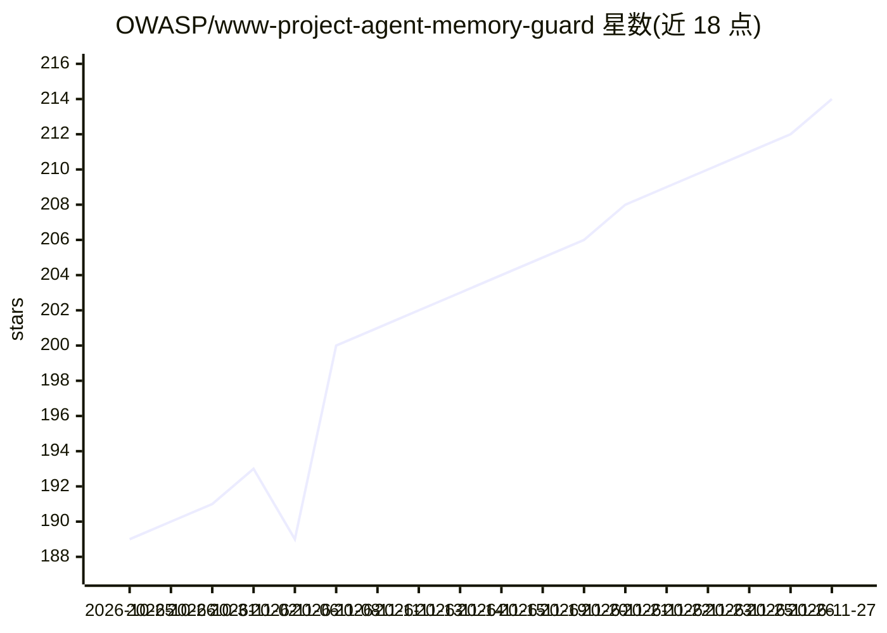

# OWASP/www-project-agent-memory-guard

⭐ 214 · Python · Apache-2.0 · 推送 2026-11-26 · [GitHub](https://github.com/OWASP/www-project-agent-memory-guard) · [官网](https://owasp.org/projects/agent-memory-guard) · 组织维护

**给 AI agent 做内存投毒运行时防御的安全库**

OWASP 官方 Lab 项目，针对 ASI06（内存与上下文投毒）的参考实现：位于 agent 与其记忆存储之间，对每次写入运行检测器管道（提示注入、密钥/PII 泄漏、受保护键篡改、尺寸异常、自我强化循环），按 YAML 策略执行 allow/redact/quarantine/block，并输出结构化 SecurityEvent 支持取证与回滚。无需 API key、无外部调用、本地运行；提供 LangChain 中间件及 OpenAI Agents/AutoGen/mem0/CrewAI 集成示例，附带 amg-bench 基准工具。

## 筛选速览

| 维度 | 判定 | 备注 |
|---|---|---|
| AI 角色 | `ai-ecosystem` | LLM/agent 周边工具 |
| 许可风险 | `permissive` | Apache-2.0 |
| 部署形态 | `library` | 以包/库形式分发 |
| 模型依赖 | — | README 未给出锁定关系 |
| 硬件要求 | — | 无带数字的原话,不猜 |
| 安装摩擦 | `low` | 无编译、无系统依赖或容器化 |
| 成熟度 | — | 结构信号不足 |

## 能力要点

- 内存写入级检测管道与 YAML 策略（allow/redact/quarantine/block）
- 无 API key、无外部调用，本地运行，中位延迟 62 µs
- LangChain GuardedChatMessageHistory/Middleware 中间件与多框架集成
- AMSB 框架中立基准，三方法适配器即可为任意记忆系统打分

## 适用场景

- 为持久化记忆的 agent 加装内存投毒防线
- 用 amg-bench 给自己的记忆系统做韧性评级
- 通过 SecurityEvent 接入 SIEM 做审计取证

## 场景标签

`Agent 记忆` `网络安全` · 领域:Agent 开发

## 证据(README 行号)

> L9:  🏆 Official OWASP Lab Project · reference implementation for ASI06: Memory &amp; Context Poisoning
> L83: Agent Memory Guard sits between the agent and its memory store, screening every operation through a pipeline of det
> L149: - **Drop-in middleware** — ships with `GuardedChatMessageHistory` for LangChain; framework-agnostic `MemoryStore` 

## 星数曲线

2026-10-25 189 → 2026-11-27 214（+25）

---
*卡片 v1 · prompt 1.4 · 生成 2026-11-27 · 置信度 high · 依据 README sha `5e46503b7154` · [字段定义](../../DATASET.md)*
