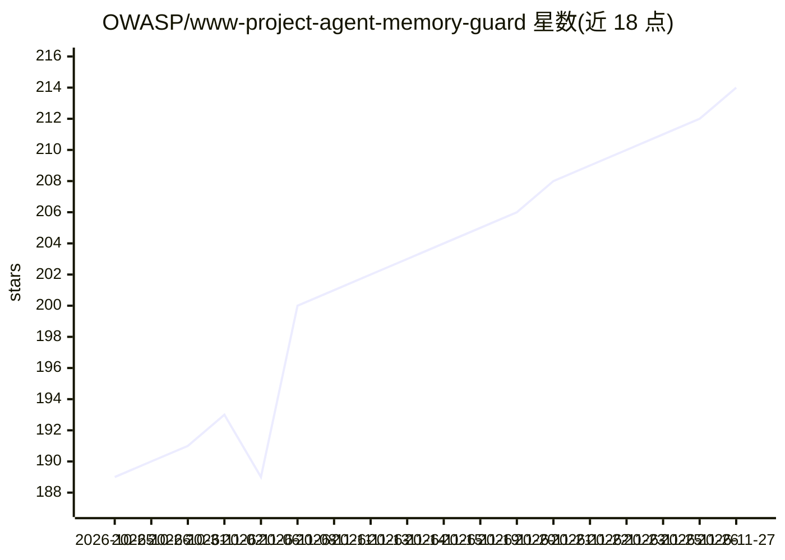

# OWASP/www-project-agent-memory-guard

⭐ 214 · Python · Apache-2.0 · 推送 2026-11-26 · [GitHub](https://github.com/OWASP/www-project-agent-memory-guard) · [官网](https://owasp.org/projects/agent-memory-guard) · 组织维护

**AI agent 记忆投毒的运行时防护中间件库**

OWASP 官方 Lab 项目，作为 ASI06（记忆与上下文投毒）的参考实现：在 agent 与其记忆存储之间拦截每次写入，通过检测器管道（prompt 注入、密钥/PII 泄露、受保护键篡改、尺寸异常、自我强化循环）与 YAML 声明式策略执行 allow/redact/quarantine/block 动作。无 API key、无外部调用、本地运行，中位延迟 62 µs；提供 LangChain 中间件、OpenAI Agents/AutoGen/mem0/CrewAI 适配器、SecurityEvent 取证与快照回滚、AMSB 基准评分工具 amg-bench。pip 安装。

## 筛选速览

| 维度 | 判定 | 备注 |
|---|---|---|
| AI 角色 | `ai-ecosystem` | LLM/agent 周边工具 |
| 许可风险 | `permissive` | Apache-2.0 |
| 部署形态 | `library` | 以包/库形式分发 |
| 模型依赖 | — | README 未给出锁定关系 |
| 硬件要求 | — | 无带数字的原话,不猜 |
| 安装摩擦 | `low` | 无编译、无系统依赖或容器化 |
| 成熟度 | — | 结构信号不足 |

## 能力要点

- pip 安装、三行代码接入，无需 API key 与外部调用
- 内置五类检测器，支持 SHA-256 完整性基线与 YAML 策略
- LangChain 中间件覆盖模型输入/输出与工具输出
- 自研 AMSB 基准并公开自身 D 级评分结果

## 适用场景

- 为持久化记忆的 agent 加上防投毒写入检查
- 给 LangChain agent 的输入输出与工具输出套上防护中间件
- 用 amg-bench 给自己的记忆系统打弹性分
- 导出 SecurityEvent 到 SIEM 做取证与合规映射

## 场景标签

`Agent 记忆` `网络安全` · 领域:Agent 开发

## 证据(README 行号)

> L9:  🏆 Official OWASP Lab Project · reference implementation for ASI06: Memory &amp; Context Poisoning
> L83: Agent Memory Guard sits between the agent and its memory store, screening every operation through a pipeline of det
> L149: - **Drop-in middleware** — ships with `GuardedChatMessageHistory` for LangChain; framework-agnostic `MemoryStore` 

## 星数曲线

2026-10-25 189 → 2026-11-27 214（+25）

---
*卡片 v1 · prompt 1.4 · 生成 2026-11-26 · 置信度 high · 依据 README sha `baf16191e4f6` · [字段定义](../../DATASET.md)*
