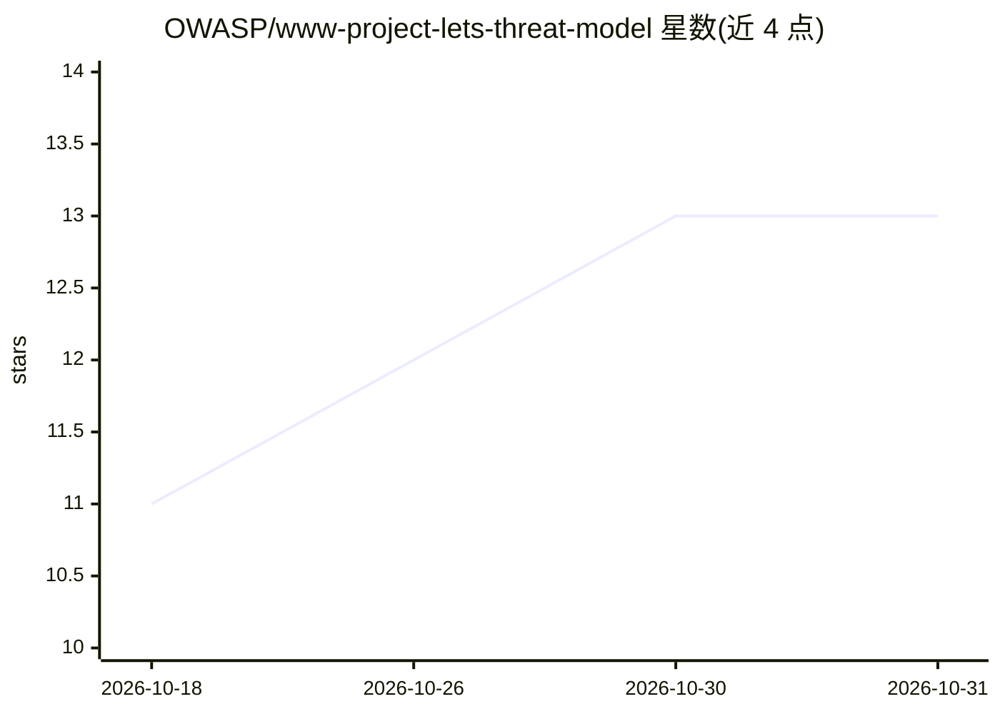

# OWASP/www-project-lets-threat-model

⭐ 13 · Python · NOASSERTION · 推送 2026-02-02 · [GitHub](https://github.com/OWASP/www-project-lets-threat-model) · 组织维护

**OWASP 出品的 Agentic AI 威胁建模工具，自动生成威胁模型报告**

读取含资产与仓库信息的 YAML 配置，用 Agentic AI 分析远程或本地代码仓库结构，生成威胁模型报告，输出 Markdown、JSON 与 SARIF 三种格式；SARIF 可接入 GitHub Code Scanning 及支持 SARIF 的 IDE。配置中可分别指定分类、评审、建模、报告各环节所用模型及上下文窗口、批量文件数等参数。提供预构建 Docker 镜像与 Python 源码两种运行方式，需设置 LLM 提供商 API key 与 GitHub 凭据等环境变量。由 OWASP 项目维护，面向安全与开发团队。

## 筛选速览

| 维度 | 判定 | 备注 |
|---|---|---|
| AI 角色 | `ai-native` | 本体是模型或模型工具 |
| 许可风险 | `none` | NOASSERTION |
| 部署形态 | `self-host` | docker 或自建部署 |
| 模型依赖 | — | README 未给出锁定关系 |
| 硬件要求 | — | 无带数字的原话,不猜 |
| 安装摩擦 | `low` | 无编译、无系统依赖或容器化 |
| 成熟度 | — | 结构信号不足 |

## 能力要点

- YAML 配置驱动的仓库威胁分析（远程 URL 或本地路径二选一）
- 分类/评审/建模/报告四个 agent 可分别指定模型与 token 参数
- 输出 Markdown/JSON/SARIF，SARIF 兼容 GitHub Code Scanning 与 IDE
- 提供预构建 Docker 镜像与 include/exclude 文件模式过滤

## 适用场景

- 在敏捷开发流程中尽早生成威胁模型报告
- 把威胁模型结果接入 GitHub Code Scanning 查看漏洞
- 对自有资产（含认证类型、数据分级）做结构化威胁分析

## 场景标签

`网络安全` · 领域:学习与行业

## 证据(README 行号)

> L4: Let's Threat Model is an Agentic AI tool that helps teams identify and manage threats early in the development lifec
> L9: - Generates an **Agentic AI-driven threat model report** based on repository structure and metadata.

## 星数曲线

2026-10-18 11 → 2026-10-31 13（+2）

---
*卡片 v1 · prompt 1.4 · 生成 2026-10-31 · 置信度 mid · 依据 README sha `f1ba9981c980` · [字段定义](../../DATASET.md)*
