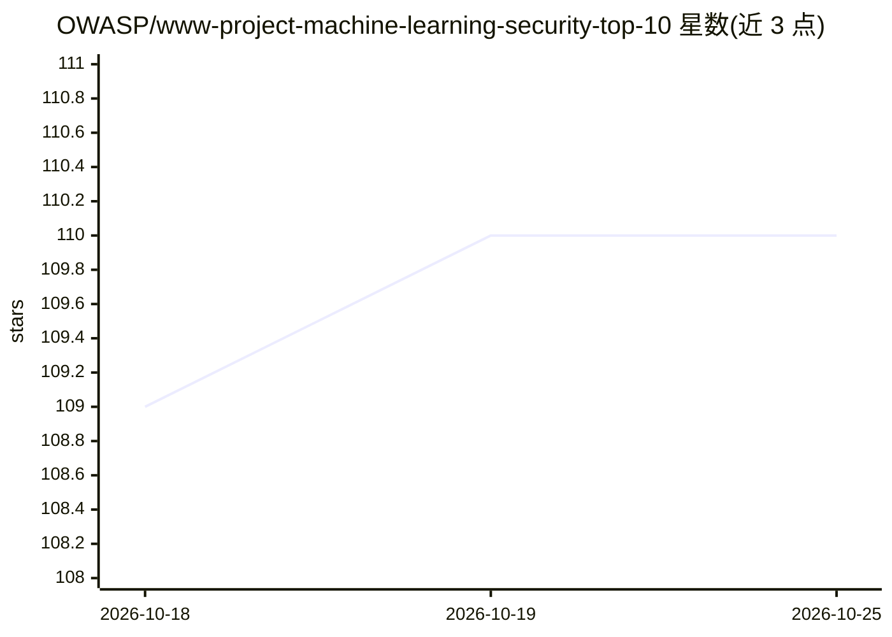

# OWASP/www-project-machine-learning-security-top-10

⭐ 110 · HTML · NOASSERTION · 推送 2026-10-07 · [GitHub](https://github.com/OWASP/www-project-machine-learning-security-top-10) · [官网](http://owasp.org/www-project-machine-learning-security-top-10/) · 组织维护

**OWASP 机器学习系统安全十大风险清单项目**

OWASP 孵化项目，目标是给出机器学习系统的十大安全风险概览，属于安全知识清单类交付物。初始版本由 Sagar Bhure 与 Shain Singh 贡献，鼓励社区按行为准则参与，通过项目 wiki 提供贡献入门信息，采用 all-contributors 规范记录贡献者，许可为 CC BY-SA 4.0。README 本身未列出具体风险条目，内容指向项目 wiki 与工作章程。

## 筛选速览

| 维度 | 判定 | 备注 |
|---|---|---|
| AI 角色 | `ai-knowledge` | 知识聚合/清单类 |
| 许可风险 | `none` | NOASSERTION |
| 部署形态 | `None` |  |
| 模型依赖 | — | README 未给出锁定关系 |
| 硬件要求 | — | 无带数字的原话,不猜 |
| 安装摩擦 | `low` | 无编译、无系统依赖或容器化 |
| 成熟度 | — | 结构信号不足 |

## 能力要点

- 以十大安全风险清单形式组织机器学习安全议题
- 初始版本由 Sagar Bhure 与 Shain Singh 贡献，社区协作评审
- 提供贡献指南 wiki 与反馈表单

## 适用场景

- 了解机器学习系统的主要安全风险分类
- 作为 ML 安全建设与培训的参考材料
- 以贡献者身份参与清单的编写与评审

## 场景标签

`精选清单` · 领域:学习与行业

## 证据(README 行号)

> L11: The primary aim of the OWASP Machine Learning Security Top 10 project is to
> L12: deliver an overview of the top 10 security issues of machine learning systems.

## 星数曲线

2026-10-18 109 → 2026-10-25 110（+1）

---
*卡片 v1 · prompt 1.4 · 生成 2026-10-23 · 置信度 high · 依据 README sha `9d79750db1cf` · [字段定义](../../DATASET.md)*
