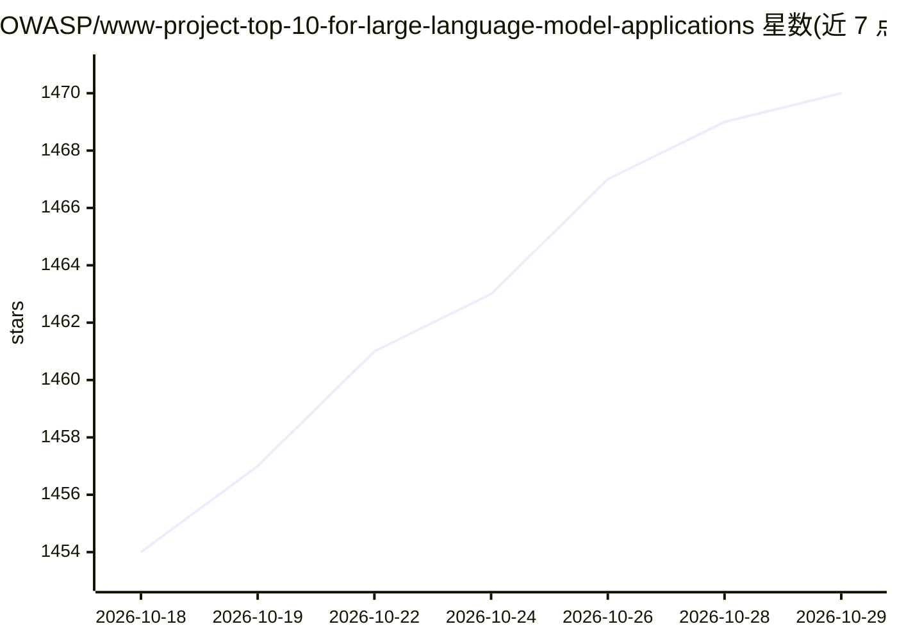

# OWASP/www-project-top-10-for-large-language-model-applications

⭐ 1,470 · Python · NOASSERTION · 推送 2026-08-05 · [GitHub](https://github.com/OWASP/www-project-top-10-for-large-language-model-applications) · [官网](http://genai.owasp.org) · 组织维护

**OWASP LLM 应用 Top 10 安全风险清单的历史归档仓库**

OWASP Top 10 for Large Language Model Applications 的原始项目页仓库，现为历史归档与旧入口：保存历史版本、翻译、工作文件与支撑材料，使既有链接与引用继续可用。当前开发已迁移至 GenAI-Security-Project/GenAI-LLM-Top10，最新版本为 2026 年 8 月发布的 OWASP GenAI LLM Top 10。本仓库不接受新的 issue 与 PR，许可为 CC BY-SA 4.0。

## 筛选速览

| 维度 | 判定 | 备注 |
|---|---|---|
| AI 角色 | `ai-knowledge` | 知识聚合/清单类 |
| 许可风险 | `none` | NOASSERTION |
| 部署形态 | `None` |  |
| 模型依赖 | — | README 未给出锁定关系 |
| 硬件要求 | — | 无带数字的原话,不猜 |
| 安装摩擦 | `low` | 无编译、无系统依赖或容器化 |
| 成熟度 | — | 结构信号不足 |

## 能力要点

- 收录 OWASP Top 10 for LLM Applications 的历史版本与多语言翻译
- 声明为遗留入口与历史归档，活跃开发已迁移至 GenAI Security Project
- 指向 2026 年 8 月发布的 OWASP GenAI LLM Top 10 当前版本
- 内容以 CC BY-SA 4.0 许可发布

## 适用场景

- 查阅 LLM 应用十大安全风险的历史版本与翻译
- 维护既有引用链接的可用性
- 作为 GenAI 安全项目的资料入口跳转到当前版本

## 场景标签

`网络安全` · 领域:学习与行业

## 证据(README 行号)

> L18: This repository powered the original OWASP project page and contains historical releases, translations, working fil
> L22: The Top 10 is now a core initiative within the broader OWASP GenAI Security Project, which develops freely availabl

## 星数曲线

2026-10-18 1,454 → 2026-10-29 1,470（+16）

---
*卡片 v1 · prompt 1.4 · 生成 2026-10-21 · 置信度 high · 依据 README sha `de40e9fbebdd` · [字段定义](../../DATASET.md)*
