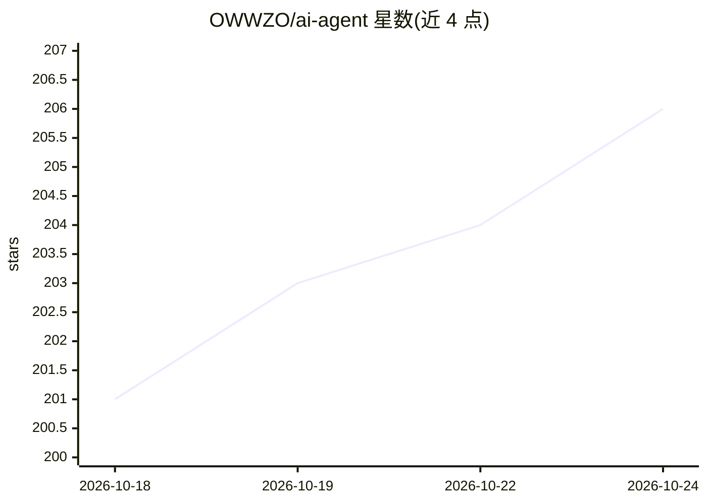

# OWWZO/ai-agent

⭐ — · [GitHub]() · 组织维护 · 中文 README

**面向全网研究与数据分析的云端多 Agent 智能体（Reactor）**

名为 Reactor 的云端智能体应用：调度多 Agent 从 Reddit、X、YouTube、BiliBili、小红书、Hacker News、GitHub 等公开渠道并行采集信息，结合多模态 RAG 解析私有文档、NL2SQL 问数与 E2B 沙箱代码执行，输出 GenUI 画布及 PDF/Word/PPT/HTML 等报告，并沉淀长期记忆。架构上拆为 Java Agent Runtime（Spring Boot/Spring AI）、Python 工具运行时与 React 工作台三部分。需自备 OpenAI-compatible LLM API 与 MySQL 8，自源码构建部署，JDK 21/Maven/Node.js 20+/Python 3.11+ 为环境要求；Qdrant、Elasticsearch、E2B 等为可选能力。

## 筛选速览

| 维度 | 判定 | 备注 |
|---|---|---|
| AI 角色 | `ai-native` | 本体是模型或模型工具 |
| 许可风险 | `none` | — |
| 部署形态 | `self-host` | docker 或自建部署 |
| 模型依赖 | — | README 未给出锁定关系 |
| 硬件要求 | — | 无带数字的原话,不猜 |
| 安装摩擦 | `low` | 无编译、无系统依赖或容器化 |
| 成熟度 | — | 结构信号不足 |

## 能力要点

- 多平台公域采集：Reddit/X/YouTube/B站/小红书/HN/GitHub 等 13+ 渠道
- 多模态 RAG 知识库 + NL2SQL + E2B 沙箱 CodeAct 数据分析
- GenUI 交互画布与 PDF/DOCX/PPTX/HTML/Markdown/Excel 产物交付
- Multi-Agent 协作、Human-in-the-loop 审批、长期记忆与 MCP 工具生态

## 适用场景

- 在正式会议前聚合目标人物全平台公开动态与观点
- 跨平台做热点舆情分析与竞品调研并生成报告
- 对业务数据库用自然语言问数并完成结构化数据分析
- 整合私有 PDF/Word/PPT 文档与公网信息做深度研究

## 场景标签

`多智能体` `RAG` `数据分析` `Agent 记忆` · 领域:Agent 开发

## 证据(README 行号)

> L7:  一个面向全网研究与复杂数据分析的云端智能体，能在公开网络、YouTube、BiliBili、X、小红书、Hacker News上研究任何主题
> L36: - **全域采集**：调度多个智能体并行采集网页信息、Reddit 社区讨论、X 平台动态、YouTube 字幕内容、小红书互动数据，以及由真实资金与内幕信息定价的 Polymarket 预测赔率。
> L39: - **分析与交付**：结合 E2B 沙箱的代码执行能力与专属数据分析 Agent，完成数据清洗、交叉验证与深度分析，最终以 GenUI 交互画布和 PDF、Word、PPT、HTML 等多格式报告自动交付。

## 星数曲线

2026-10-18 201 → 2026-10-24 206（+5）

---
*卡片 v1 · prompt 1.4 · 生成 2026-10-22 · 置信度 mid · 依据 README sha `14b0d35ceff7` · [字段定义](../../DATASET.md)*
