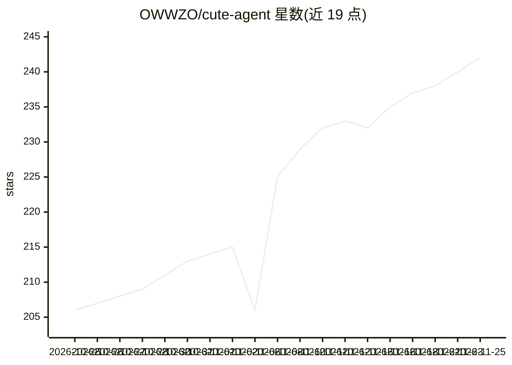

# OWWZO/cute-agent

⭐ 242 · Java · 推送 2026-11-22 · [GitHub](https://github.com/OWWZO/cute-agent) · 个人维护 · 中文 README

**面向全网研究与数据分析的多智能体云端工作台**

以 Java（Spring AI）为运行时、Python 为工具层、React 为工作台的三服务架构智能体应用：并行调度多个 Agent 采集 Reddit、X、YouTube、BiliBili、小红书等平台内容，结合多模态 RAG 私有知识库与 NL2SQL 问数，经 E2B 沙箱执行代码分析，最终以 GenUI 画布及 PDF/Word/PPT/HTML 报告交付。提供长期记忆、上下文压缩、Human-in-the-loop 审批与 MCP 工具发现机制。部署需 JDK 21、Maven、Node.js 20+、Python 3.11+ 与 MySQL 8，支持自定义 OpenAI-compatible LLM API。

## 筛选速览

| 维度 | 判定 | 备注 |
|---|---|---|
| AI 角色 | `ai-native` | 本体是模型或模型工具 |
| 许可风险 | `none` | — |
| 部署形态 | `self-host` | docker 或自建部署 |
| 模型依赖 | — | README 未给出锁定关系 |
| 硬件要求 | — | 无带数字的原话,不猜 |
| 安装摩擦 | `low` | 无编译、无系统依赖或容器化 |
| 成熟度 | — | 结构信号不足 |

## 能力要点

- 多 Agent 协作：同步/异步子 Agent、任务控制与上下文隔离
- 可溯源多模态 RAG：文本/图片向量加 BM25，命中片段可追溯
- CodeAct 数据分析 Agent 与 E2B 沙箱代码执行
- GenUI 交互画布与多格式文档生成，支持主题模板导入

## 适用场景

- 跨平台调研某话题在 Reddit、X、小红书上的真实讨论与舆论
- 上传私有 PDF/Word 文档与公网情报交叉做事实核查
- 用自然语言问数据库并生成可视化分析报告
- 会议或出行前聚合目标人物/目的地的全网动态

## 场景标签

`多智能体` `RAG` `数据分析` · 领域:Agent 开发

## 证据(README 行号)

> L7:  一个面向全网研究与复杂数据分析的云端智能体，能在公开网络、YouTube、BiliBili、X、小红书、Hacker News上研究任何主题
> L312: Cute 把实时 Agent 编排和重型工具执行拆开：Java 负责运行时、策略、会话、HITL 和执行账本；Python 负责搜索、RAG、数据处理、文档生成和代码沙箱；React 负责流式工作台、产物预览和 GenUI 渲染
> L214: 仓库内置 `evals/agent` 评测侧车，支持同一题目集分别运行 Cute Agent 与 Codex CLI，

## 星数曲线

2026-10-25 206 → 2026-11-25 242（+36）

---
*卡片 v1 · prompt 1.4 · 生成 2026-11-25 · 置信度 mid · 依据 README sha `fdc24f22bfba` · [字段定义](../../DATASET.md)*
