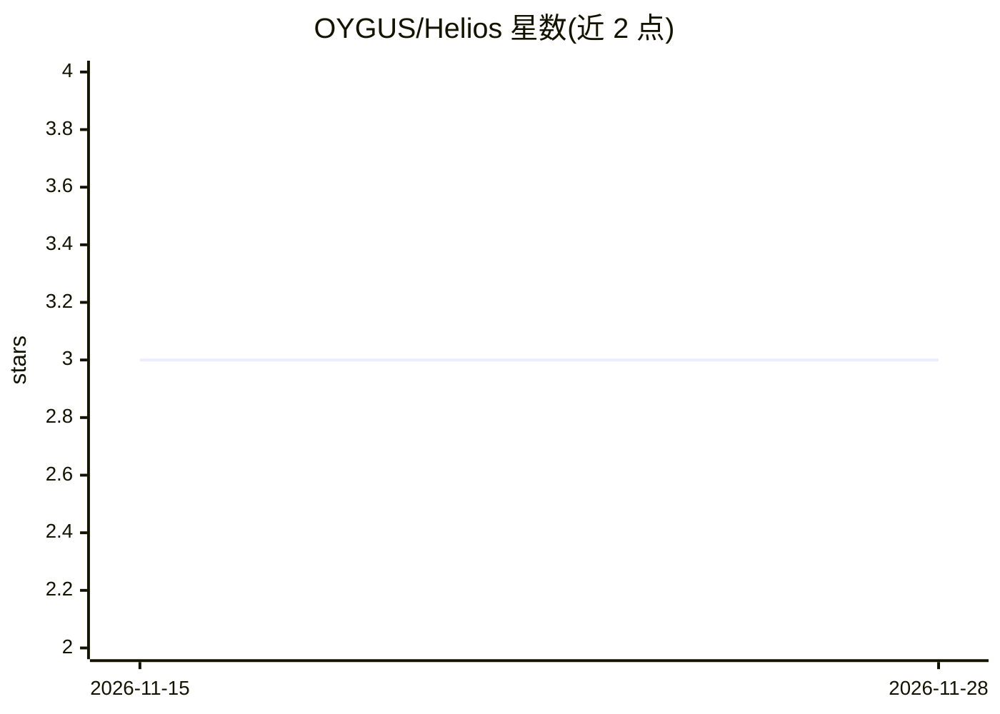

# OYGUS/Helios

⭐ 3 · Python · MIT · 推送 2026-11-20 · [GitHub](https://github.com/OYGUS/Helios) · 个人维护

**把本地代码库与 AI 编码会话可视化为交互式知识图谱的桌面应用**

PySide6 桌面应用：扫描本地文件夹，基于真实 import 关系绘制模块依赖图，支持手动增删节点与连线、搜索、过滤，并导出 PNG/Markdown。可读取 Antigravity、OpenAI Codex、Claude Code 的本地会话日志，把使用过的项目汇总为 Work History。可选接入 Ollama 生成项目简介文字建议（仅文本，不改图）。支持全离线运行，数据全部留在本地；仅支持四种语言的依赖连线分析。

## 筛选速览

| 维度 | 判定 | 备注 |
|---|---|---|
| AI 角色 | `ai-enhanced` | 去掉 AI 部分产品仍成立 |
| 许可风险 | `permissive` | MIT |
| 部署形态 | `desktop` | 安装包/桌面程序 |
| 模型依赖 | local-ok | 支持本地模型 |
| 硬件要求 | — | 无带数字的原话,不猜 |
| 安装摩擦 | `low` | 无编译、无系统依赖或容器化 |
| 成熟度 | — | 结构信号不足 |

## 能力要点

- 从 import 关系绘制模块依赖图，不做猜测（支持 Python/JS/TS/PHP/HTML）
- 导入 Antigravity、Codex、Claude Code 本地会话日志
- 可选 Ollama 本地生成项目描述文字建议
- 一键复制可粘贴给编码 agent 的项目概览 prompt，提供 CLI bridge 供 agent 更新运行中的应用

## 适用场景

- 把接手或维护的代码库梳理成可视化架构图
- 汇总多个 AI 编码工具里做过的项目历史
- 为编码 agent 准备项目上下文 prompt
- 全离线环境下浏览和管理本地代码项目结构

## 场景标签

`知识图谱` · 领域:知识与检索

## 证据(README 行号)

> L12: - **Optional local AI (Ollama).** If you have Ollama, it can write short descriptions and suggest a purpose. A sugg
> L75: Helios works fully without AI. If Ollama and a model are installed on your computer, Helios finds them on its own. 
> L3: Helios is a desktop app that turns your local code projects and your AI coding sessions into an interactive map of h

## 星数曲线

2026-11-15 3 → 2026-11-28 3（+0）

---
*卡片 v1 · prompt 1.4 · 生成 2026-11-28 · 置信度 high · 依据 README sha `363911375d5c` · [字段定义](../../DATASET.md)*
