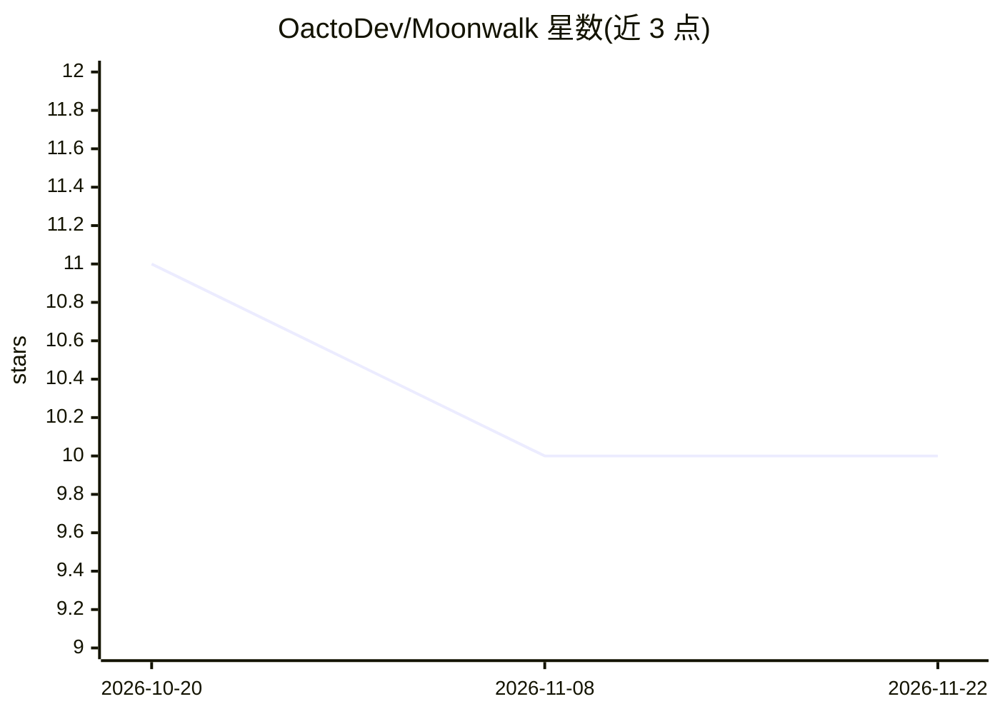

# OactoDev/Moonwalk

⭐ 10 · Python · 推送 2026-03-17 · [GitHub](https://github.com/OactoDev/Moonwalk) · [官网](https://www.getmoonwalk.top) · 个人维护

**macOS 桌面 AI 助手：语音/文字控制你的 Mac**

基于 Electron + Python 的 macOS 桌面助手，以透明玻璃胶囊悬浮层形式呈现，通过语音唤醒词或快捷键接收指令，用 LLM 规划并经 Accessibility API 与 AppleScript 执行系统操作。核心机制为 SPAV（Sense→Plan→Act→Verify）代理循环，支持里程碑式执行、浏览器自动化（Chrome 扩展桥接网页操作）、本地隐私模式与部署到 GCP Cloud Run 的云端模式。限 macOS 平台，构建需打包为 DMG。

## 筛选速览

| 维度 | 判定 | 备注 |
|---|---|---|
| AI 角色 | `ai-native` | 本体是模型或模型工具 |
| 许可风险 | `none` | — |
| 部署形态 | `desktop` | 安装包/桌面程序 |
| 模型依赖 | — | README 未给出锁定关系 |
| 硬件要求 | — | 无带数字的原话,不猜 |
| 安装摩擦 | `low` | 无编译、无系统依赖或容器化 |
| 成熟度 | — | 结构信号不足 |

## 能力要点

- SPAV 代理循环：感知→规划→执行→验证，含里程碑式执行
- 语音唤醒（Hey Moonwalk / ⌘⇧Space）与命令面板双入口
- Chrome 扩展桥接实现网页搜索、表单填写、数据提取
- 本地模式数据不出机，云模式部署 GCP Cloud Run + Firestore

## 适用场景

- 用语音让助手代为操作 Mac 上的应用
- 自动化网页搜索、表单填写与信息提取
- 多用户常驻部署时将大脑服务放到云端运行

## 场景标签

`AI 助手` · 领域:对话与助手

## 证据(README 行号)

> L3: **AI desktop assistant for macOS** — a transparent glass-pill overlay that uses voice and text to control your Mac.
> L14: - **SPAV Agent** — Sense → Plan → Act → Verify loop with milestone-based execution

## 星数曲线

2026-10-20 11 → 2026-11-22 10（-1）

---
*卡片 v1 · prompt 1.4 · 生成 2026-11-20 · 置信度 high · 依据 README sha `8ba0478e0a84` · [字段定义](../../DATASET.md)*
