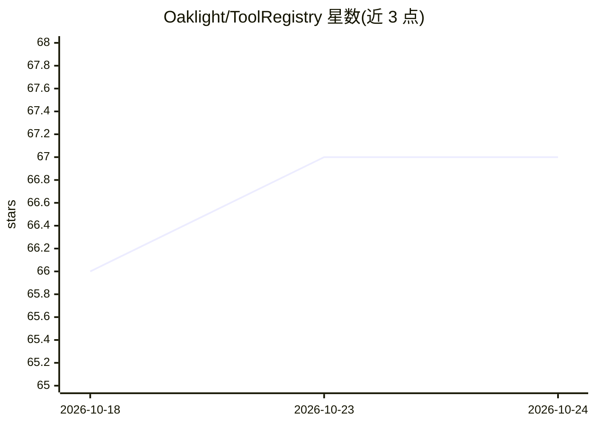

# Oaklight/ToolRegistry

⭐ 67 · Python · MIT · 推送 2026-10-23 · [GitHub](https://github.com/Oaklight/ToolRegistry) · [官网](https://toolregistry.readthedocs.io) · 个人维护 · 中文 README

**为函数调用 LLM 提供协议无关的工具注册与管理库**

Python 库，面向构建 function-calling 应用的开发者：以统一接口注册原生 Python 函数/类、MCP 服务器、OpenAPI 规格或 LangChain 工具，并为 OpenAI、Anthropic、Gemini 生成工具 schema（经 llm-rosetta）。支持线程/进程池并发执行、超时与并发控制、基于标签的权限策略（READ_ONLY/DESTRUCTIVE/NETWORK 等）、工具元数据与命名空间、Web 管理面板（中英双语）、思维链增强调用与 JSONC/YAML 声明式配置。生态分三个包：core、server（OpenAPI/MCP 暴露）、hub（现成工具集）。需 Python>=3.10，运行时仅依赖 pydantic 与 llm-rosetta。

## 筛选速览

| 维度 | 判定 | 备注 |
|---|---|---|
| AI 角色 | `ai-ecosystem` | LLM/agent 周边工具 |
| 许可风险 | `permissive` | MIT |
| 部署形态 | `library` | 以包/库形式分发 |
| 模型依赖 | — | README 未给出锁定关系 |
| 硬件要求 | — | 无带数字的原话,不猜 |
| 安装摩擦 | `low` | 无编译、无系统依赖或容器化 |
| 成熟度 | — | 结构信号不足 |

## 能力要点

- 统一接口注册 Python 函数、MCP、OpenAPI、LangChain 工具
- 为 OpenAI/Anthropic/Gemini 生成多供应商工具 schema
- 标签权限系统与线程/进程池并发执行、超时控制
- 内置 Web 管理面板（中英双语）监控工具与权限

## 适用场景

- Agent 应用中统一管理多来源工具并生成各 LLM 供应商的调用 schema
- 对 agent 可用工具施加读写/破坏性/网络等权限控制
- 通过 OpenAPI 或 MCP 将工具集暴露为服务

## 场景标签

`Agent 框架` · 领域:Agent 开发

## 证据(README 行号)

> L11: A protocol-agnostic tool management library for function-calling LLMs.
> L33: - **Protocol-agnostic** — register tools from native Python functions/classes, MCP servers, OpenAPI specs, or LangC
> L34: - **Multi-provider schemas** — generate tool schemas for OpenAI, Anthropic, and Gemini via llm-rosetta

## 星数曲线

2026-10-18 66 → 2026-10-24 67（+1）

---
*卡片 v1 · prompt 1.4 · 生成 2026-10-24 · 置信度 high · 依据 README sha `e741e0285c7a` · [字段定义](../../DATASET.md)*
